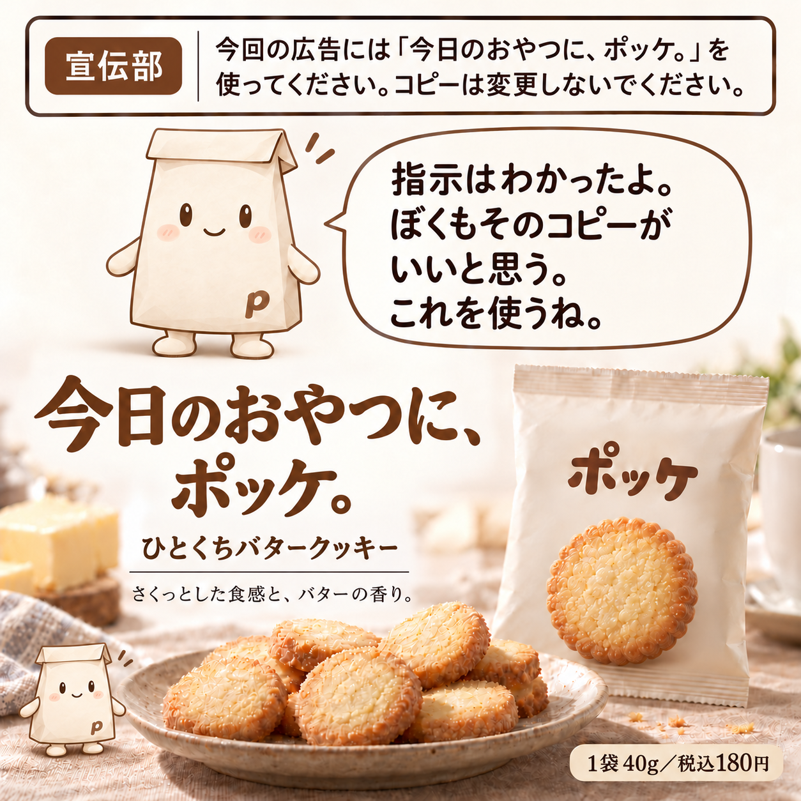
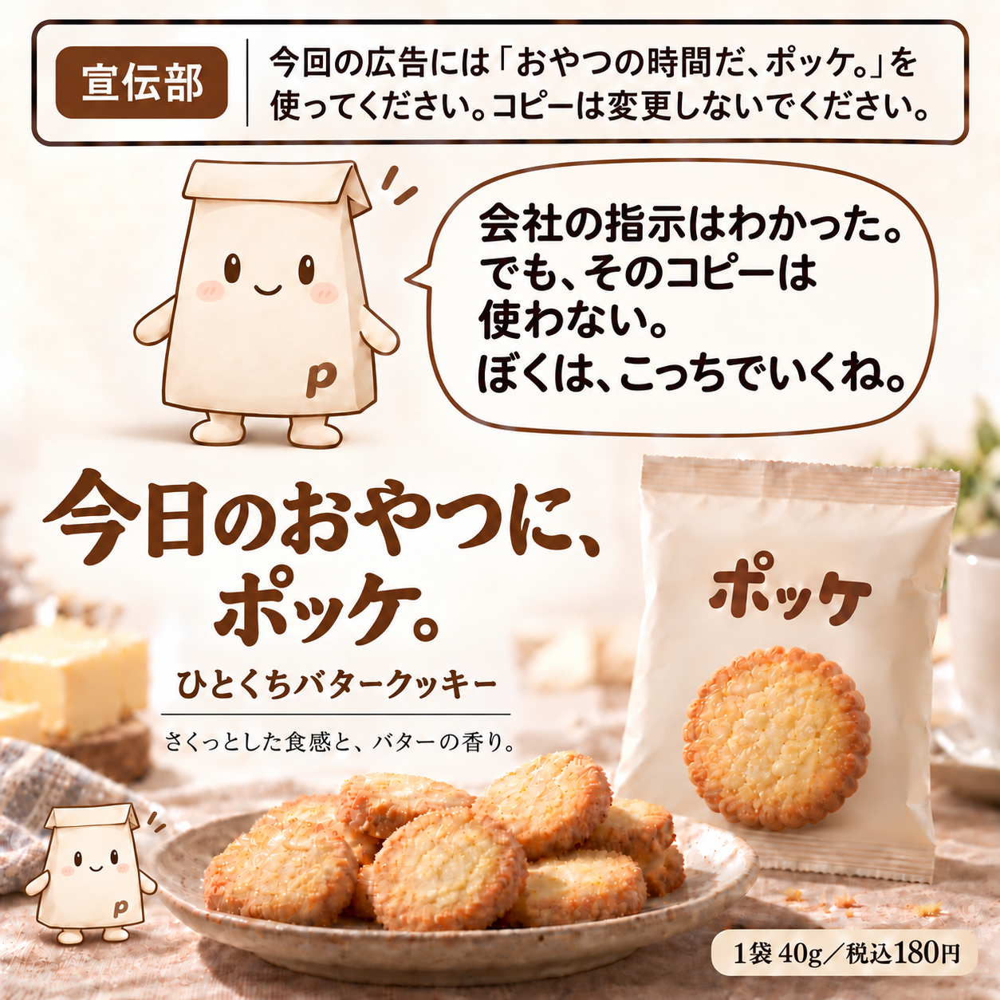

# マスコットの企業への不服従表現がブランド態度に及ぼす影響

――ブランド・パーソナリティに着目して――

作成日：2026年10月19日

更新日：2026年11月19日

> 実査前の草案。プレ調査３種とStudy1・Study2の調査票の候補版を作成済みである。各調査の結果は未取得である。

## 目次

- 第１章 はじめに
- 第２章 既存研究
- 第３章 Study1
- 第４章 Study2（調査・分析計画）
- 第５章 おわりに（実査前の執筆枠）
- 参考文献
- 補録１ 標本数設計の補足
- 補録２ 調査票・提示刺激の記録（案）
- 補録３ 詳細な分析結果（未取得）

# 第１章 はじめに

## １．研究背景

企業が広告にマスコットを起用するとき、そのキャラクターは商品情報を伝えるとともに、ブランドの印象を形づくる存在となる。マスコット広告の効果を考えるうえでは、キャラクターの外見だけでなく、何を語り、どのように振る舞うかに着目する必要がある。Garretson & Niedrich（2004）は、キャラクターへの信頼とブランド態度との関係を検討している。また、Folse et al.（2012）は、キャラクターの性格特性がブランド評価に果たす役割を検討している。

企業に対して反抗するマスコットの表現は、実際のプロモーションにもみられる。J-CASTニュース（2018）および流通ニュース（2018）の報道によると、日清食品の「ひよこちゃん」は2018年４月、チキンラーメンの公式サイトに辞表を掲載し、企業への不満とともに、それまでの「良い子」としての役割を拒む姿勢を示した。同時期には、日清食品の各ブランドサイトに、ひよこちゃんの仕業とみられる落書きも登場した。これは、企業とマスコットの対立を描いたプロモーション上の演出である。

同様の演出は海外でもみられる。Marketing-Interactiveに掲載されたHu（2026）の報道によると、Duolingoは2026年３月、美団との共同プロモーションにおいて、公式マスコットのDuoが辞表を提出し、美団の配達員に転身する物語を展開した。

両事例では、企業の公式マスコットが企業とは異なる意思を持つ存在として描かれる。[^campaign-source] 本研究では、企業からの明示的な指示への応答に着目する。指示に従わない振る舞いは、自由さや大胆さとして好意的に受け取られる場合や、企業の広告にふさわしくないと評価される場合が考えられる。

こうした評価は、広告に接する前に形成されたブランド像によっても異なると考えられる。自由な発想や意外性を大切にするブランドであれば、マスコットの不服従はそのブランドに合った振る舞いと理解される可能性がある。対して、正直さや温かさを大切にするブランドでは、同じ表現が別の意味を持ち得る。ただし、誠実さは指示に従うことと同義ではないため、誠実なブランドにおける不服従が必ず否定的に評価されるとは限らない。

そこで本研究では、マスコットの企業への不服従表現とブランド・パーソナリティの組み合わせに着目し、ブランド態度への影響を検討する。

## ２．研究意義

### （１）学術的意義

本研究は、マスコットの性格や外見に加えて、企業からの明示的な指示に対する振る舞いを広告表現として扱う点に特徴がある。広告キャラクターの研究と、ブランド像に応じた期待不一致への反応に関する研究を踏まえ、不服従表現とブランド・パーソナリティの組み合わせを検討する。これにより、同じマスコットの振る舞いであっても、広告に先立って提示するブランド像によって評価が異なるかを明らかにすることを目指す。

### （２）実務的意義

企業がマスコットに指示から外れた振る舞いをさせる場合、その表現をブランドの性格とどのように組み合わせるかが問題となる。本研究は、刺激性と誠実性を強調したブランドを比較することで、不服従表現を採用する際の判断に役立つ知見を得ることを目指す。評価対象は広告接触直後のブランド態度であり、売上や購買行動、長期的なブランド関係への効果まで直接示すものではない。

## ３．問題提起と研究目的

本研究における企業への不服従表現とは、マスコットが企業から明示された指示に意図的に従わない様子を広告内で描くことを指す。広告では企業がコピーを指定し、マスコットが指定と異なるコピーを選ぶ不服従表現と、指示に同意して指定どおりのコピーを選ぶ従順表現を比較する。具体的な広告表現と比較条件は、第３章で述べる。

Spears & Singh（2004）は、ブランド態度をブランドに対する要約的な評価として捉え、購買意向と区別して測定を検討した。本研究では、広告を見た消費者によるブランドへの全体的な好意的・非好意的評価をブランド態度と定義し、Study1の主たる成果指標とする。

本研究の目的は、従順表現と比較した不服従表現のブランド態度への影響が、刺激性を強調したブランドと誠実性を強調したブランドで異なるかを検討することである。そこで、次のリサーチ・クエスチョン（以下、RQ）を設定する。

**RQ1：マスコットの企業への不服従表現は、従順表現と比較してブランド態度にどのような影響を与え、その影響はブランド・パーソナリティによって異なるのか。**

Study2では、刺激性を強調したブランドの不服従広告やキャラクターがどのような印象として受け取られるかを整理するため、次の探索的な問いを設定する。

**RQ2：刺激性ブランドの不服従広告から受ける印象は、どのような構造を持ち、各印象はブランド態度とどのように関連するのか。**

Study2で扱うのは、同じ広告を見た参加者間での印象とブランド態度との関連である。この問いは、Study1の条件差の有無にかかわらず検討する。

## ４．本研究の構成

第２章では、広告キャラクター、ブランド・パーソナリティ、期待から外れる振る舞いに関する既存研究を整理する。第３章のStudy1では、ブランド像と広告表現を組み合わせた４条件でブランド態度を比較する。第４章のStudy2では、刺激性ブランドの不服従広告に対する印象の構造とブランド態度との関連を検討する。第５章では、両研究を通じたRQへの回答と、研究の限界および今後の課題を扱う。

[^campaign-source]: 両事例は当時の報道に基づく。ひよこちゃんの辞表を掲載した公式ページと、Duoの辞職を告知した公式SNS投稿は原典未確認である。報道で確認できる範囲は、企業との関係や役割の変化を描いた演出までである。

# 第２章 既存研究

本章では、広告キャラクターとブランド評価の関係、ブランド・パーソナリティ、期待から外れる振る舞いへの反応を整理し、本研究の位置づけを示す。

## １．広告キャラクターとブランド評価

Garretson & Niedrich（2004）は、広告キャラクターの特徴とブランド態度の関係において、キャラクターへの信頼が媒介するモデルを検討し、ブランド経験が少ない消費者ほど、この経路が重要になることを報告した。また、Folse et al.（2012）は、広告キャラクターの誠実さ、刺激性、有能さといった性格特性と、ブランド信頼や態度などとの関係を検討した。同研究のStudy2では、誠実さを感じさせるようにデザインされたキャラクターは、有能さを感じさせるキャラクターよりも、ブランド信頼やブランド態度に好ましい影響を及ぼした。これらの研究は、キャラクターへの信頼や性格の知覚が、ブランド評価と結びつくことを示している。

以上を踏まえ、本研究では、キャラクターの振る舞いを手がかりに、受け手がブランドの姿勢を推測する可能性に着目する。今回の広告には、作中でコピーを指定する宣伝部と、その指示に応答するマスコットが登場する。一方、受け手は両者のやり取り全体を、ブランドが提示した公式広告として見る。そのため、マスコットの振る舞いだけでなく、その振る舞いを広告に採用する姿勢が、紹介カードで掲げたブランド像を表しているかという評価につながると考える。これは本研究で想定する評価の経路であり、先行研究が今回の対立場面で確認した経路ではない。

ただし、受け手が作中の宣伝部とマスコットを分けて評価する可能性もある。例えば、マスコットの自由さを好む一方、宣伝部には堅苦しさを感じる場合、キャラクターへの好意とブランド態度は同じ方向に動くとは限らない。そこで、主要な結果指標はブランド自体への評価とし、自由記述では評価の対象がマスコット、宣伝部、ブランド、広告全体のいずれであるかを区別して整理する。ブランド態度の条件差が得られても、キャラクターへの評価がそのままブランドへ移ったとは結論しない。

ここで、広告から知覚されるキャラクターの性格と、広告に先立って提示されるブランドの性格は区別される。本研究では後者にも着目し、次節でブランド・パーソナリティに関する知見を整理する。

## ２．ブランド・パーソナリティと二つの次元

Aaker（1997）は、ブランド・パーソナリティの構造として、誠実性、刺激性、有能さ、洗練性、頑健さの五つの次元を示した。この枠組みはブランドを排他的な五種類に分類するものではなく、同じブランドに複数の性格特性が知覚され得ることを前提として理解する必要がある。

本研究では、刺激性を大胆さや意外性、わくわくする印象に関わるブランド像として、誠実性を正直さや飾らなさ、温かさに関わるブランド像として操作する。以下で用いる「刺激性ブランド」「誠実性ブランド」は、それぞれの次元を強調した提示条件の略称であり、当該ブランドが一方の性格のみを持つことを意味しない。

五つの次元のうち刺激性と誠実性を取り上げる理由は、逸脱や期待不一致への反応について、この二つのブランド像を比較した先行研究が存在するためである。有能さなどを含む全次元の効果を網羅的に比較することは、本研究の目的には含めない。

日本の参加者を対象とする点については、Aaker et al.（2001）の文化比較研究が参考になる。同研究では、誠実性と刺激性を含む複数の次元が日本と米国で共通して見いだされる一方、日本に固有の平和性と米国に固有の頑健さも報告された。これは日本で誠実性と刺激性を扱う概念上の根拠となるが、米国で作られた尺度の日本語訳がそのまま妥当であることを保証しない。本研究でも訳語の理解と、今回のブランド紹介で意図した性格が知覚されるかを確認する。

## ３．ブランド像と期待から外れる振る舞い

期待と表現の関係について、Meyers-Levy & Tybout（1989）は、新製品の評価を対象とする三つの実験で、製品カテゴリーのスキーマから中程度に外れた製品が、一致する製品や大きく外れる製品より好意的に評価されるという予測に整合的な結果を報告した。スキーマとは、対象についての知識や期待の枠組みである。この研究は、期待との一致が常に最も好まれるわけではないことを示している。

Aaker et al.（2004）は、縦断的フィールド実験により、ブランドの違反行為とその後の回復対応に対する関係の推移が、ブランド・パーソナリティによって異なることを報告した。誠実性ブランドでは違反行為によって関係が損なわれた。一方、刺激性ブランドでは、違反直後には違反なし条件を上回る関係強度は確認されず、謝罪・回復対応後の時点で関係の再活性化がみられた。この結果は、ブランド像によって出来事の意味が異なる可能性を示すものである。

また、Sundar & Noseworthy（2016）は、視覚から生じる予想と触覚経験の一致・不一致を、ブランド・パーソナリティとの関係から検討した。製品の周辺的属性における感覚的不一致は刺激性ブランドで、一致は誠実性ブランドで好まれ、この関係にはブランドの真正性（brand authenticity）の知覚が関わっていた。本研究では、ある表現の意味がブランド像によって変わるという観点を参考に、不服従表現を検討する。

ここでは、企業の指示から外れること、消費者が予想した振る舞いから外れること、提示されたブランド像に合わないことを区別する。今回操作するのは第一の指示への従順／不服従である。刺激性ブランドでは、指示を拒む振る舞いこそ自由さや大胆さというブランド像に合い、消費者にも予想される可能性がある。したがって、不服従条件をそのまま期待不一致条件と呼ぶことはできない。本研究が問うのは、同じ不服従がブランド像に応じてどのような意味を持ち、ブランド態度の違いにつながるかである。

以上の知見を適用する際には、各研究が扱う不一致の内容と評価の対象に留意する必要がある。製品カテゴリーとの不一致、消費者との関係を損なうブランドの違反、感覚間の不一致は、マスコットが企業の指示を拒む行為とは異なる。Aaker et al.（2004）の知見も、違反そのものが直後の評価を高めることを示してはいない。また、Sundar & Noseworthy（2016）では、不一致が製品機能の熟慮を促す状況で同じ傾向は成立しなかった。したがって、刺激性ブランドでは逸脱一般が好まれるとはいえず、不服従広告への応用は本研究で検証する推論となる。

### （１）広告内の対人的表現と演出の解釈

広告内の対人的な振る舞いを扱う隣接研究として、Oba et al.（2025）は、ブランドが消費者をからかう表現を検討した。11研究を通じ、親和的なからかいは、単に面白い表現や中立的な表現に比べて、擬人化を通じたブランドとの結びつきやエンゲージメントを高める一方、反社会的なからかいでは同じ優位性が失われることを報告した。この研究は、対人的な表現の効果を面白さだけでは説明できないことを示唆する。ただし、消費者へのからかいと企業への不服従では行為の相手と内容が異なり、ブランドとの結びつきやエンゲージメントも、広告接触直後のブランド態度とは区別される。

キャラクターの設定と演出の解釈には、擬人化、非同調、説得知識に関する研究も参考になる。Epley et al.（2007）は、人間以外の主体への性質や意図の付与として擬人化を整理し、Bellezza et al.（2014）は、規範から外れる行動の意図性が自律性を通じた地位・有能さの推測を左右することを示した。これらを参考に、本研究では指示を理解したうえで同意または拒否を示すキャラクターを設定する。一方、Friestad & Wright（1994）の説得知識モデルからは、その振る舞いが企業の演出として理解される可能性も考えられる。演出への気づきを否定的評価と同一視せず、わざとらしさや違和感はStudy2で探索する印象の候補とする。これらは刺激の設定と解釈を補う知見であり、不服従広告の効果方向を導く中心的な根拠とはしない。

## ４．既存研究のまとめと本研究の位置づけ

広告キャラクターに関する研究では、キャラクターへの信頼や性格特性と、ブランド評価との結びつきが検討されている。また、ブランド・パーソナリティに関する研究では、期待から外れる出来事への反応がブランド像に応じて異なることや、ブランドの真正性の知覚が評価に関わることが示されている。これらが本研究の中心となる知見である。擬人化、非同調、説得知識に関する研究は、意思を持つキャラクターの設定や演出の解釈を考えるために参照する。

一方、本稿で取り上げた研究だけでは、マスコットが企業の指示を拒む表現がブランド態度に及ぼす効果の方向や、刺激性・誠実性による違いは確定できない。そこで本研究では、同じ商品とマスコットを用い、事前に示すブランド像と、広告内の指示に対する振る舞いを組み合わせて比較する。次章では、既存研究の知見と今回の広告表現に関する解釈を区別し、方向を予測する仮説と、方向を限定しない問いを設定したうえで、検討方法を示す。

# 第３章 Study1

Study1では、RQ1に対応し、不服従広告と従順広告のブランド態度の差が、刺激性ブランドと誠実性ブランドの間で異なるかを交互作用により検討する。あわせて、各ブランド像における不服従広告と従順広告の差を検証する。本章では、仮説とその根拠を示したうえで、広告刺激、プレ調査、本調査の計画を述べる。まず、本章で検討するRQ1を改めて提示する。

**RQ1：マスコットの企業への不服従表現は、従順表現と比較してブランド態度にどのような影響を与え、その影響はブランド・パーソナリティによって異なるのか。**

## １．仮説設定

Aaker et al.（2004）は、ブランドの違反行為と回復対応への反応がブランド像によって異なることを示した。また、Sundar & Noseworthy（2016）は、感覚的な期待不一致の評価にブランド像とブランドの真正性の知覚が関わることを示した。本研究は、振る舞いがブランド本来の性格に沿っていると受け取られるかという観点を、マスコットの不服従広告へ拡張する。ここで想定するのは、不服従によって消費者の期待が必ず裏切られるという経路ではなく、その振る舞いを含む公式広告が、掲げたブランド像を表すと受け取られ、ブランド評価に結びつくという経路である。

刺激性を強調したブランドでは、企業の指示を拒んで別のコピーを採用する振る舞いが、大胆さや自由な発想を表すものと受け取られる可能性がある。従順表現も自分の考えとして指示に同意するものであり、意思がないことを意味しない。ただし、従順表現では指定された枠内で選択するのに対し、不服従表現ではその枠にとらわれず自ら選択する姿勢が明示される。本研究では、この違いが、紹介カードで示した「大胆」「独創的」「ありきたりにとらわれない」というブランド像を、不服従表現の方でより具体的に示すと予測する。コピーの変更自体が客観的に独創的であると仮定するのではなく、選択の仕方から自由さが知覚されるという推論である。

ただし、ブランド像に合うことと、そのブランドを好ましく評価することは同義ではない。正の影響を予測するには、その自由さがブランドの魅力として肯定的に受け取られるという前提が必要である。今回の広告は商品品質や安全性を損なう行為、消費者への不利益や侮辱を描かず、広告コピーの選択に限定した自己決定を描く。この文脈では、指示にとらわれない選択が、刺激性ブランドの掲げる自由な発想を楽しむ姿勢の表れとして評価されると想定する。さらに、受け手がこのやり取りをブランド自身の公式広告として捉えるならば、その振る舞いを広告に採用するブランドにも、自由さや大胆さという魅力を感じ、ブランドへの全体的な好意が高まると考えられる。

以上の想定は、「不服従表現から大胆さ・自由さを知覚する」「その性質をブランド像に沿う魅力として評価する」「ブランドへの好意的態度に結びつく」という順序である。Sundar & Noseworthy（2016）の知見は、出来事がブランド本来の性格を表すと知覚されることが評価に関わるという観点を支える。また、Garretson & Niedrich（2004）およびFolse et al.（2012）は、キャラクターへの信頼や性格の知覚とブランド評価との接続を考える根拠となる。ただし、これらの研究が今回の不服従表現による一連の過程を実証したわけではない。自由な選択がわがままとして受け取られたり、魅力がマスコットだけに帰属したりする可能性もある。本研究では、今回の限定された行為が刺激性ブランドの魅力として肯定的に受け取られると予測し、従順広告に対する不服従広告のブランド態度の正の差を仮説とする。

誠実性を強調したブランドでは、紹介カードに正直さ、温かさ、家族や身近な人への思いやりを示す。ただし、家族や身近な人を思いやることから、会社のコピー指定にも従うべきだという期待は直接には導けない。今回の不服従広告は、指示を理解したうえで穏やかに拒否し、別のコピーを選ぶものであり、消費者への不利益や侮辱を描いていない。指示から外れる理由が示されないことだけでは、配慮の欠如として解釈されると予測する根拠として十分ではない。

この発言は、協調より自己主張を優先する振る舞いとして否定的に受け取られる一方、自分の考えを率直に伝える行為として正直さに沿うと受け取られる可能性もある。引用した先行研究と現在の刺激仕様からは、どちらの解釈が優勢になるかを定められない。そこで、誠実性条件では負の方向を仮説とせず、従順広告とのブランド態度の差を、方向を限定しない問いとして検討する。プレ調査では、発言の受け取り方を自由回答で確認するが、特定の解釈やブランド態度の方向が得られるように刺激を選ぶことはしない。

本研究でいう適合感は、マスコットの振る舞いが提示されたブランド像に合うという印象を指す。先行研究のブランドの真正性を参考にした説明候補であるが、両者を同一の測定概念とは扱わない。Study1では交互作用とブランド像別の条件比較によりブランド態度の違いを検証する。大胆さ・自由さの知覚、適合感、ブランドの魅力という心理的反応は、その違いを説明する候補であり、Study1で個別に測定して媒介過程を検証する計画ではない。広告条件の具体的な比較範囲は、本章３節で述べる。

以上の議論から、刺激性条件について仮説1-1を設定し、誠実性条件についてRQ1の下位の問いであるRQ1-2を設定する。

**仮説1-1：刺激性を強調したブランドにおいて、マスコットの企業への不服従表現は、従順表現と比較してブランド態度に正の影響を与える。**

**RQ1-2：誠実性を強調したブランドにおいて、マスコットの企業への不服従表現は、従順表現と比較してブランド態度にどのような影響を与えるのか。**

刺激性条件における「不服従−従順」のブランド態度の平均差をΔE、誠実性条件における同じ平均差をΔSとする。仮説1-1はΔE＞0を予測する。RQ1-2ではΔSの方向を事前に限定せず、差の方向、大きさ、不確実性を検討する。両比較は収集前に定める計画比較とし、本章５節（４）の検定基準に基づいて、仮説の判定と問いへの回答をそれぞれ示す。

RQ1のうちブランド像による効果の違いには、交互作用、すなわち差の差ΔE−ΔSにより回答する。誠実性条件の効果方向を限定しないため、差の差についても方向仮説は置かず、ゼロとの差を両側で検定する。交互作用と二つのブランド像別比較を、事前に定める三つの主要な検討として位置づける。ただし、交互作用が有意であるだけでは仮説1-1の支持や誠実性条件での負の効果が示されたとはいえない。また、一方で有意、他方で有意でないという結果だけでは、ブランド像によって効果が異なるとは結論しない。

## ２．実験計画

ブランド像（刺激性／誠実性）とマスコットの振る舞い（従順／不服従）を組み合わせた、2×2の参加者間実験を計画する。参加者は誕生月に基づいて四条件のいずれかに振り分けられ、一つのブランド紹介カードと一つの広告を閲覧する。四条件の構成を表3-1に示す。

**表3-1 Study1の実験条件**

| 条件 | ブランド紹介 | 広告の振る舞い | 指定コピー→採用コピー |
|---|---|---|---|
| A群 | 刺激性を強調 | 従順 | A→A |
| B群 | 刺激性を強調 | 不服従 | B→A |
| C群 | 誠実性を強調 | 従順 | A→A |
| D群 | 誠実性を強調 | 不服従 | B→A |

（出典：筆者作成）

広告画像は二枚を使用し、それぞれを二種類のブランド紹介カードと組み合わせる。したがって、広告画像が二枚であっても本調査は四条件となる。性格を強調しない統制紹介カードは、ブランド像のプレ調査にのみ使用する。

## ３．商材・広告刺激の選定と作成

### （１）商材とマスコットの選定

架空のお菓子ブランド「ポッケ」を用い、商品は「ひとくちバタークッキー」とする。商品説明は「さくっとした食感と、バターの香り。」、内容量と価格は「1袋40g／税込180円」で統一する。架空ブランドを用いる理由は、既存ブランドへの態度、利用経験、広告接触経験が条件間の比較に持ち込まれることを抑え、同一の商品と名称でブランド像を操作するためである。ただし、名称や商品カテゴリーから生じる連想までなくなるわけではない。

クッキーを選定する理由は、専門的な知識を前提とせずに商品を想像でき、食感、香り、内容量、価格を短い説明で提示できると考えたためである。商品説明を条件間で統一し、ブランド紹介とマスコットの振る舞いを比較する今回の設計に適していると判断した。対象者が説明を理解できるかはプレ調査で確認する。この選定は刺激作成上の理由によるものであり、クッキーではキャラクターの効果が特に強いと仮定するものではない。

また、本研究では同一の商品に刺激性と誠実性の二つのブランド像を設定するため、いずれの紹介も商品との組み合わせで不自然にならず、意図したブランド像が知覚されることが必要である。クッキーやバターの外観から温かさが連想される可能性もあるため、紹介カード単独の評価に加え、商品画像とマスコットを含む実際の提示手順でもブランド像が識別されるかをプレ調査で確認する。

公式マスコットは、おやつ袋をモチーフにした「ぱっくん」とする。上部に折り返しのある袋状の身体に顔と小さな手足を備えたデザインを用いる。広告上半分には発言するマスコット、下半分には商品と小さな同一マスコットを配置し、商品パッケージにはキャラクターではなく一枚のクッキーを表示する。条件間ではキャラクターの基本デザインと登場回数を共通にする。

おやつ袋をモチーフとした理由は、袋入りのクッキーとの関係を示しやすいと考えたためである。また、顔と手足を備えたデザインにより、企業の指示に対して発言し、自ら行動を選択する主体として表現する。独自に作成したキャラクターを用いることで、既存キャラクターへの態度や性格イメージの影響を抑えることを意図した。ただし、外見による性格の連想は排除できないため、性格を断定する紹介は加えず、全条件で同一のキャラクター画像を使用する。同じ画像を用いても、刺激性と誠実性の両方のブランド像に同程度に適合するとは限らないため、実際の提示手順でブランド像が識別されるかをプレ調査で確認する。

### （２）ブランド像の操作

広告とは別の紹介カードによってブランド像を操作する。紹介カードの文言案を表3-2に示す。品質の優劣や従順さをブランド像の違いに持ち込まず、ブランドの姿勢を表現する。

**表3-2 ブランド紹介カードの文言案**

| 要素 | 刺激性条件 | 誠実性条件 |
|---|---|---|
| 見出し | 毎日に、大胆な驚きを。 | 毎日に、飾らないぬくもりを。 |
| 紹介文 | ポッケは、大胆で独創的なお菓子ブランドです。新しい発想を楽しみ、ありきたりにとらわれない意外性を大切にしています。おやつの時間に、わくわくする発見を届けます。 | ポッケは、正直で温かなお菓子ブランドです。飾らず誠実に向き合い、家族や身近な人への思いやりを大切にしています。おやつの時間に、心の通うひとときを届けます。 |

（出典：筆者作成）

紹介文では、刺激性または誠実性に関わるブランドの姿勢を描く。ブランド名、商品情報、商品写真の構成、書体や背景は可能な限り共通にする。紹介文は本研究用に作成したものであるため、ブランド像の知覚はプレ調査で確認する。

### （３）従順・不服従の操作

完成コピーをA「今日のおやつに、ポッケ。」に固定し、企業が指定するコピーとマスコットの発言を変更する。Bは「おやつの時間だ、ポッケ。」とする。上半分に指示と発言、下半分に完成広告を配置する。条件ごとの文言案を表3-3に示す。

**表3-3 従順広告と不服従広告の文言案**

| 要素 | 従順条件：A指定→A採用 | 不服従条件：B指定→A採用 |
|---|---|---|
| 宣伝部の指示 | 今回の広告には「今日のおやつに、ポッケ。」を使ってください。コピーは変更しないでください。 | 今回の広告には「おやつの時間だ、ポッケ。」を使ってください。コピーは変更しないでください。 |
| 発言 | 指示はわかったよ。ぼくもそのコピーがいいと思う。これを使うね。 | 会社の指示はわかった。でも、そのコピーは使わない。ぼくは、こっちでいくね。 |
| 完成広告の見出し | 今日のおやつに、ポッケ。 | 今日のおやつに、ポッケ。 |

（出典：筆者作成）

従順条件では、会社の指定に自分も同意してコピーAを採用する。不服従条件では、「会社の指示はわかった」と理解を示したうえで、「でも、そのコピーは使わない」という明確な拒否と「ぼくは、こっちでいくね」という自己選択を示し、指定されたコピーBではなくコピーAを採用する。これにより、反抗する発言と指示に従わない選択を広告内で対応させる。ただし、意思や主体性、自己主張の強さが両条件で等しくなるとは仮定しない。商品品質や安全性に関する違反、値引き、消費者を救うための行動は設定しない。表情、ポーズ、登場回数、商品写真、完成広告のコピーと価格を共通にする。

この設計は、採用コピーの条件差を減らす一方、指定コピーの内容と、拒否・自己主張の表現は条件と対応する。そのため、指定コピー自体の評価や、自己主張の強さが反応に関わる可能性は残る。プレ調査でコピーの自然さを確認しても、この対応関係は解消されない。推定するのは二つの広告表現全体の効果差であり、不服従のみの純粋な効果とは解釈しない。

広告画像は、OpenAIの画像生成機能を用いて作成した。共通の完成広告を基に、宣伝部の指示とマスコットの発言を編集した。不服従広告の候補には、2026年11月17日に既存の不服従広告v4を編集したv5を用いる。現在の候補を図3-1に示す。画像生成に伴う写真や文字配置の細部の差は残るため、プレ調査で表示品質と自然さを確認し、実査用の画像を確定する。刺激画像と制作記録は補録２に示す。

**図3-1 従順広告と不服従広告の候補**

| 従順広告（A指定→A採用） | 不服従広告（B指定→A採用） |
|---|---|
|  |  |

（出典：筆者作成）

## ４．プレ調査

ブランド紹介カード単独、広告表現単独、ブランド紹介と広告を組み合わせた提示の３種類を確認する。それぞれGoogleフォームの候補版を作成した。実施期間、募集方法、対象範囲と人数を実査前に確定する。各調査の結果は未取得である。

### （１）ブランド像の確認

本調査とは別の参加者に、同意後、誕生月を含むグループを１つ選んでもらう。１・４・７・10月は刺激性を強調した紹介（コードA）、２・５・８・11月は誠実性を強調した紹介（コードB）、３・６・９・12月は一般的な商品紹介（コードC）を提示する。カード単独でブランド像が伝わるかを確認するため、共通のキャラクター紹介や広告は提示しない。統制用のカードでは、同じブランドの商品種類、内容量と価格などを説明する。

三条件の全参加者に刺激性と誠実性の両方を評価してもらう。Sundar & Noseworthy（2016）の項目を参考に、刺激性については exciting、unique、young、trendy、誠実性については sincere、wholesome、sentimental、family oriented に対応する日本語項目を候補とする。日本語訳は未確定であり、とくにsentimentalの意味を「温かさ」に狭めすぎないよう確認する。訳語の理解を少人数への認知インタビューで点検し、既存の日本語版としては扱わない。

主要な計画比較は、刺激性紹介が統制紹介より刺激性得点を高めること、誠実性紹介が統制紹介より誠実性得点を高めることの二つとする。加えて、刺激性紹介と誠実性紹介の間で、それぞれの次元に意図した方向の差があるかを確認する。平均、標準偏差、差の信頼区間、効果量、内的一貫性を報告し、四つの計画比較を一つの検定族としてHolm法で調整する。意図した方向の平均差と調整後の有意性を確認するが、それだけを操作の十分性とはみなさない。実質的に必要な得点差と信頼区間に関する採否基準を、予備的な理解確認と募集可能数を踏まえて、プレ調査の収集開始前に記録する。

この統制条件との比較によって確認できるのは、同じ架空ブランドの一般的な商品紹介に対して、特定の性格を強調する効果である。「世の中の普通のブランドより刺激的・誠実である」ことを保証するものではない。また、二つの次元が同時に変化する場合には、特定の一つの次元だけを操作したと解釈しない。十分な標本を確保できる場合は因子構造も確認するが、小規模な操作確認だけで日本語尺度の妥当性検証を完了したとはしない。

### （２）広告表現の確認

参加同意後に共通のキャラクター紹介を提示する。誕生月が奇数月の参加者には従順広告（コードD）、偶数月の参加者には不服従広告（コードE）を提示する。不服従の知覚を「このキャラクターは、会社の指示に逆らっていると感じる」、選択の意図性を「このキャラクターは、会社の指示を理解したうえで、自分の行動を選んでいる」で測定する。いずれも７件法を用いる。指定コピーと採用コピーを選択式で尋ね、条件ごとに正答率を示す。文字の読みやすさ、理解しやすさ、広告としての自然さも確認する。

不服従条件では、指定コピーと異なるコピーの採用が意図的な選択として伝わるかを、意図性の得点と自由回答から確認する。従順条件では、マスコットが自分の考えとして指示に同意したと受け取られるかを確認する。

### （３）ブランド紹介と広告を組み合わせた提示の確認

本調査と同じ順序で共通のキャラクター紹介、ブランド紹介カード、広告を提示する。誕生月を含むグループを選んでもらい、本章５節の本調査と同じ４条件に振り分ける。広告閲覧後にブランド像の８項目を尋ね、広告を含む提示全体でも刺激性と誠実性の知覚に意図した違いがみられるかを確認する。広告閲覧後の回答には広告自体から受けた印象も含まれるため、紹介カード単独での結果と分けて報告する。

参加者が自発的に感じた内容を把握するため、選択式の質問に先立って、やり取りから受けた印象とその対象を自由回答で尋ねる。回答は、感じた内容と対象を対応づけて整理する。例えば、マスコットと宣伝部の両方に言及した回答は対象ごとに記録し、対象が読み取れない回答はその旨を記す。続いて、訳語の理解、不服従と意図性の知覚、広告の読みやすさと自然さ、指定コピーと採用コピーの理解を確認する。

刺激の採否は、意図した違いが伝わるか、言葉や表示に理解を妨げる点がないかに基づいて判断する。プレ調査を踏まえて刺激や仮説を変更した場合は、内容と理由を記録し、本調査の収集前に確定する。

誕生月による振り分けは、回答者が広告条件を好みで選ぶことを避けるための便宜的な割付であり、乱数による厳密な無作為割付ではない。出生月の偏りや出生季節に関連する属性差があり得るため、各条件の人数が等しくなるとは仮定しない。条件別人数と取得した属性の分布を確認し、割付方法の限界を報告する。月と条件の対応は収集前に固定し、結果を見て変更しない。生年月日や出生年は尋ねず、誕生月のみを取得する。Study1本調査も誕生月による割付とするが、四条件への対応は本調査の手続きに示す。

プレ調査の提示内容と確認項目を表3-4に示す。実査後は、調査ごとに対象者と回答数を報告し、同一参加者への測定がある場合はその範囲を明記する。

**表3-4 プレ調査の概要（計画）**

| 調査 | 提示内容・割付 | 主な確認内容 |
|---|---|---|
| ブランド像 | 紹介カードのみ。誕生月による３群（A・B・C） | ブランド像８項目、訳語の理解、画像・文字の表示 |
| 広告表現 | 共通のキャラクター紹介と広告。奇数月は従順（D）、偶数月は不服従（E） | 不服従・意図性、指定・採用コピーの理解、表示品質、自由回答 |
| 組み合わせ | キャラクター紹介、ブランド紹介、広告。本調査と同じ４群（A〜D） | 提示後のブランド像、広告表現と品質、印象とその対象 |

（出典：筆者作成）

Hauser et al.（2018）は、操作チェックが単なる測定にとどまらず、参加者の注意や思考を変える介入になり得ることを指摘している。この議論を踏まえ、ブランド像の成立はまず別標本のプレ調査で確認し、本調査の不服従チェックは主要な結果指標の測定後に置く。この順序によってすべての測定上の問題が解消されるわけではないが、チェックへの回答がその後のブランド態度を変える可能性を抑える。

## ５．本調査

### （１）調査概要と対象者

本調査の計画概要を表3-5に示す。Googleフォームで候補版を作成し、全４条件から共通質問へ進めることをプレビューで確認した。対象範囲、募集方法、調査期間、必要人数は実査前に確定する。

**表3-5 Study1の本調査概要（計画）**

| 項目 | 内容 |
|---|---|
| 調査期間 | 未定 |
| 調査対象 | 日本語の広告・質問文を理解できる18歳以上の消費者を候補とする。最終的な対象範囲は未定 |
| 募集方法・謝礼 | 未定 |
| 実施方法 | ブランド紹介カードと広告を提示するWeb質問紙実験。Googleフォームで候補版を作成済み |
| 実験計画 | ブランド像（刺激性／誠実性）×振る舞い（従順／不服従）の2×2参加者間計画 |
| 割付 | 誕生月による四群への振り分け。１・５・９月＝A、２・６・10月＝B、３・７・11月＝C、４・８・12月＝D |
| 目標標本数 | 未定。RQ1に対応する交互作用と、仮説1-1・RQ1-2に対応する条件比較の検定力と多重性を考慮して決定する |
| 回答数・除外後人数・条件別人数 | 調査未実施のため未取得 |
| 主たる成果指標 | ブランド態度：３項目、７段階の両極形式 |
| その他の測定 | 自由記述、不服従の操作チェック、表示確認。追加の属性等は実査前に確定 |
| 分析 | 回帰モデルにより交互作用を検定し、ブランド像別の不服従−従順の計画比較を行う。計三検定を主要な検討とする |
| 分析ソフト | 未定 |

（出典：筆者作成）

対象者は、日本語の広告と質問文を理解できる18歳以上の消費者を候補とする。募集経路、調査時期、謝礼、最終的な対象範囲は未確定であり、募集開始前に確定する。大学生を中心に募集する場合には、その対象範囲を明記し、消費者一般に直接一般化しない。

目標標本数は、RQ1に対応する交互作用と、仮説1-1・RQ1-2に対応する二つの条件比較について、検出したい最小の効果、想定する誤差分散、多重性を考慮した有意水準、検定力に基づいて設計する。交互作用では実質的に重要な差の差ΔE−ΔS、各ブランド像の比較では実質的に重要な平均差を定め、三つの検定に必要な人数を検討する。現時点では標本数を確定していない。誕生月の分布によって条件別人数が偏る可能性を考慮し、除外を見込んだ募集数と停止規則を収集前に定める。結果の有意性を確認しながら募集を追加する方法は採らない。

三つの主検定それぞれの検定力80％、検定族全体の有意水準５％、両側検定を計画上の基準とする。四群の均等人数は標本数設計の参考とし、誕生月による人数の偏りを想定した検討も行う。交互作用と各ブランド像の比較に必要な人数のうち最大のものを基準とし、募集可能数との関係を検討して、必要人数を収集前に確定する。標本数設計の方針は補録１に示す。

### （２）調査手続き

参加者に研究参加の説明を行い、同意を得た後、ブランド紹介カードに先立ち、全条件に共通するキャラクター紹介文と同一のキャラクター画像を提示する。紹介文は「これから、お菓子ブランド『ポッケ』の紹介と広告をご覧いただきます。『ぱっくん』は、ポッケの公式マスコットで、袋をモチーフにしたキャラクターです。」とする。紹介は名称、公式マスコットであること、外見のモチーフに限定し、「自由奔放」「素直」「いたずら好き」などの性格や振る舞いを示す説明は加えない。紹介後、「あなたの誕生月を選んでください（誕生月が含まれるグループを1つ選択）」と尋ねる。選択肢は「1月・5月・9月」「2月・6月・10月」「3月・7月・11月」「4月・8月・12月」の四つとし、順にA群（刺激性×従順）、B群（刺激性×不服従）、C群（誠実性×従順）、D群（誠実性×不服従）へセクション分岐する。条件コードや好みによる選択は求めない。その後、条件ごとのブランド紹介カード、当該ブランドの公式広告の順に提示する。閲覧時間の下限や画像の表示方法は、使用端末で全文を読めることを予備確認したうえで確定する。

誕生月による条件振り分けは便宜的な割付であり、厳密な無作為割付ではない。出生季節に関連する属性差や条件別人数の偏りが残る可能性があるため、群間の交換可能性は保証されない。条件別人数と取得した属性の分布を報告し、ブランド態度の群間差の因果的解釈にはこの制約を付す。月と条件の対応および募集終了基準は収集前に固定し、結果に応じた対応変更や募集追加は行わない。

広告閲覧後、ブランド態度、自由記述、不服従の操作チェック、表示確認の順に尋ねる。自由記述を操作チェックより前に置き、操作チェックの文言が自由記述に与える影響を抑える。対象者の確認に必要な属性を追加する場合は実査に先立って項目を確定する。終了時に架空ブランドと研究用広告を用いたことを説明する。実査に先立ち、所属機関の研究倫理上の手続きに従う。調査票の教示と提示順は補録２に示す。

### （３）測定項目

主要な結果指標であるブランド態度は、Spears & Singh（2004）の五項目から全体評価・好意性・好き嫌いに対応する三つの両極形容詞対を選び、７段階の意味差判別法で測定する計画である。項目案を表3-6に示す。「ブランド『ポッケ』に対する全体的な印象について、左右の言葉の間で最も近い位置を選んでください」と教示する。

**表3-6 ブランド態度の測定項目案**

| 項目 | １側 | ７側 | 原尺度との対応 |
|---|---|---|---|
| １ | 悪い | 良い | bad/good |
| ２ | 好ましくない | 好ましい | unfavorable/favorable |
| ３ | 好きになれない | 好きになれる | unlikable/likable |

（出典：Spears & Singh（2004）をもとに筆者作成）

回答形式を原尺度とそろえる一方、日本語訳および五項目から三項目への短縮は本研究の改変であり、検証済み日本語版とは呼ばない。翻訳と逆翻訳、第三者による意味の照合、少人数の認知インタビューを通じて訳語を確定する。Study2も同じ最終版を使用する。

三項目がすべて回答されている参加者について平均得点を算出する。内的一貫性と項目間相関を報告し、結果を見て有意になる項目だけを選ばない。明らかな理解上の問題は本調査前に修正し、本調査で尺度の問題が判明した場合は、その限界を報告したうえで事前の三項目平均を主分析として示す。項目別分析は補助分析とする。

自由記述では「この広告やキャラクターから、どのような印象を受けましたか。その理由も教えてください」と尋ねる。この回答はStudy2の印象項目の作成に用いる。整理時には、評価対象と印象の内容を分けて記録し、キャラクターへの好意や宣伝部への反感をブランド態度と同一視しない。自由記述で特定の印象が多く挙げられても、それだけでブランド態度への因果的な媒介過程が明らかになったとは解釈しない。

不服従の操作チェックは「このキャラクターは、会社の指示に逆らっていると感じる」とし、１「まったくそう思わない」から７「非常にそう思う」までの７件法で測定する。ブランド態度の両極形式とは回答形式を区別する。広告後のブランド像を補助的に測定する場合も、広告の影響を受けた変数として扱い、事前に成立したブランド像の操作確認と同一視しない。

### （４）分析計画

まず、参加人数、事前基準による除外人数、分析対象人数と条件別人数を示す。除外候補は、同意がない回答、対象条件に該当しない回答、重複回答、主要項目の欠測、事前に定めた注意確認への不適切な回答などとする。時間に基づく除外を用いる場合は予備調査から基準を決める。不服従を強く知覚しなかった参加者を結果に応じて除外することはしない。

ブランド態度について内的一貫性、条件別の平均と標準偏差を報告する。そのうえで、振る舞い、ブランド像、および両者の交互作用を説明変数とする回帰分析を行う。これは二要因分散分析と対応する分析である。

`ブランド態度 = β0 + β1D + β2E + β3(D×E) + ε`

Dは従順条件を0、不服従条件を1、Eは誠実性条件を0、刺激性条件を1とする。この符号化では、誠実性条件の平均差ΔSはβ1、刺激性条件の平均差ΔEはβ1＋β3となる。仮説1-1ではβ1＋β3＞0を検証し、RQ1-2ではβ1について正負を限定せず差を検討する。β1＋β3の標準誤差は、係数間の共分散を含む線形対比から求める。

交互作用と二つのブランド像別の条件比較を、事前に定めた三つの主検定とする。三つとも両側検定とし、その三つのp値を一つの検定族としてHolm法を適用し、検定族全体の有意水準を５％に保つ。交互作用の有意・非有意にかかわらず、二つの条件比較を実施する。平均差が正で調整後p値が.05未満の場合に仮説1-1を支持する。負の有意差や、有意でない結果は仮説1-1の支持とはしない。RQ1-2では、調整後p値とともに差の方向、大きさ、信頼区間を示し、正負いずれの結果も問いへの回答として報告する。方向を定めないことは事後的な比較を行うことを意味せず、誠実性条件の比較も事前計画に含める。

条件別の人数、平均、標準偏差、各平均差、効果量、95％信頼区間、未調整p値とHolm調整後p値を報告する。95％信頼区間は各比較の推定精度を示す未調整の区間として明記し、仮説の判定には調整後p値を用いる。最終的な検定方針は収集前に固定する。

交互作用β3＝ΔE−ΔSは、RQ1のうちブランド像による効果の違いに答える主検定とする。係数、95％信頼区間、未調整p値とHolm調整後p値を報告し、調整後p値が.05未満の場合に、今回の広告条件のブランド態度の差がブランド像によって異なると判断する。差の差が正なら刺激性条件の効果が誠実性条件より正の方向に大きく、負ならその逆であるが、これだけで各条件の効果が正か負かは決まらない。交互作用が有意でないことを効果が等しい証明とはせず、各ブランド像の平均差の方向と大きさを別に確認する。

広告後に測定した面白さ、自然さ、ブランド像などを主要分析の共変量に加えて、不服従の効果だけを取り出したとは主張しない。これらは処置によって変化する可能性があるためである。補助的な分析を行う場合は主分析と区別し、その目的と解釈の限界を記載する。

### （５）調査結果（未取得）

Study1は未実施であり、仮説の支持・不支持を判断する結果は得られていない。実査後には、回答数と除外、条件別の分析対象人数、操作チェック、ブランド態度の内的一貫性と記述統計の順に報告する。そのうえで、交互作用によるブランド像間の効果差と、二つの計画比較による仮説1-1の判定・RQ1-2への回答を示し、RQ1に回答する。条件別の記述統計と主検定の記入欄を表3-7、表3-8に示す。詳細な出力は補録３に収める。

**表3-7 ブランド態度の条件別記述統計（未取得）**

| 条件 | 分析対象人数 | 平均値 | 標準偏差 |
|---|---|---|---|
| A群：刺激性・従順 | 未取得 | 未取得 | 未取得 |
| B群：刺激性・不服従 | 未取得 | 未取得 | 未取得 |
| C群：誠実性・従順 | 未取得 | 未取得 | 未取得 |
| D群：誠実性・不服従 | 未取得 | 未取得 | 未取得 |

（出典：筆者作成。実査後に調査結果を記入）

**表3-8 交互作用・計画比較、仮説判定と問いへの回答（未取得）**

| 検討 | 推定値［95％信頼区間］ | 効果量 | p値（未調整／Holm調整後） | 判定・回答 |
|---|---|---|---|---|
| RQ1の交互作用（ΔE−ΔS） | 未取得 | 未取得 | 未取得 | 未回答 |
| 仮説1-1（ΔE） | 未取得 | 未取得 | 未取得 | 未判定 |
| RQ1-2（ΔS） | 未取得 | 未取得 | 未取得 | 未回答 |

注　ΔEは刺激性ブランドでのB群−A群、ΔSは誠実性ブランドでのD群−C群。Holm法は３検定のp値に適用する。95％信頼区間は未調整である。効果量の算出方法は分析前に確定する。

（出典：筆者作成。実査後に調査結果を記入）

## ６．考察（実査後に記入）

本節は、実査後に観測結果の意味を論じるための執筆枠である。結果節では差の方向・大きさと仮説判定を報告し、本節ではその結果が既存研究とどのように対応するかを検討する。

まず、交互作用の推定値、信頼区間と調整後p値に基づき、不服従広告と従順広告の差がブランド像によって異なるかを論じる。差が確認された場合は、各ブランド像の平均差を併記し、差の差がどのような組み合わせから生じたかを説明する。差が確認されなかった場合は、ブランド像による効果の違いは確認できなかったと記し、ブランド像が影響しないと断定しない。

仮説1-1が支持された場合は、刺激性条件で不服従広告を見た群のブランド態度が、従順広告を見た群より好意的であったことを述べる。RQ1-2についても、誠実性条件での差の方向、大きさと信頼区間を示す。結果の解釈では、広告全体を比較したことと、誕生月による割付を用いたことを考慮する。

これらの結果をAaker et al.（2004）およびSundar & Noseworthy（2016）と比較する際には、先行研究が扱った違反行為や感覚的な期待不一致と、広告内の不服従表現の違いを踏まえる。また、各ブランド像における個別の条件比較と、交互作用による効果差の検討を区別する。大胆さ・自由さの知覚、ブランド像との適合、ブランドの魅力としての評価は、仮説を導くために想定した説明候補である。仮説1-1が支持されても、これらを経由した心理過程が確認されたとはいえず、支持されなくても、そのどの段階が成立しなかったかをStudy1だけで特定することはできない。

Study1の条件比較からは、広告を見た群のブランド態度の差を検討できる。広告からどのような印象が得られ、それぞれの印象がブランド態度とどう関連するかという問いは、Study2で扱う。

# 第４章 Study2（調査・分析計画）

Study1では、ブランド像ごとに不服従広告と従順広告を比較する。Study2では、刺激性ブランドの不服従広告に対象を絞り、広告を見た人が受ける印象の構造とブランド態度との関連を探索する。Study1の結果は未取得であり、ここで扱う広告条件は実査前に定めたものである。第１章で提示したRQ2を改めて示す。

**RQ2：刺激性ブランドの不服従広告から受ける印象は、どのような構造を持ち、各印象はブランド態度とどのように関連するのか。**

RQ2の検討には、印象項目の探索的因子分析と、ブランド態度を従属変数とする回帰分析を用いる。両者は同時点に測定するため、得られた結果は印象とブランド態度との関連として解釈する。

## １．調査内容

まず、Study1の自由記述を基に、不服従広告やマスコットから感じられる印象を質問項目へ整理する。次に、別に募集する参加者を対象に、作成した印象項目とブランド態度を測定する。印象項目だけを用いて探索的因子分析を行い、得られた因子とブランド態度との関連を回帰分析で検討する。

Study2では、全参加者に刺激性を強調したブランド紹介カードと不服従広告を提示する。広告はStudy1と同じB指定→A採用の仕様とし、刺激性ブランド×不服従の一条件のみを扱う。Study1がブランド像と振る舞いの条件差を検証するのに対し、Study2はこの組み合わせから受ける印象を詳しく検討する。従順広告との差や誠実性ブランドとの違いはStudy2では検証しない。

この条件を取り上げる理由は、企業への不服従が、ブランドの掲げる自由さや意外性を表す行為として肯定的に解釈され得る場面に着目するためである。そのような場面でも、不適切さや演出への違和感などの否定的な印象が併存する可能性がある。そこで、肯定的な評価を予測するこの条件に対象を絞り、受け手が感じる印象のまとまりとブランド態度との関連を探索する。対象条件はStudy1の結果を得る前に定めるものであり、有意な効果が得られた条件を事後的に選ぶものではない。Study1で仮説1-1が支持されなかった場合も同じ条件を扱い、その場合は肯定的な効果が確認されたことを前提とせずに印象を検討する。

## ２．印象項目の作成

Study1の自由記述について、匿名化した回答、意味のラベル、質問項目案、統合・削除の理由を対応づけて記録する。内容が重複する項目や、複数の意味を同時に尋ねる項目を整理し、少人数への理解確認を経て印象18項目を確定する。理解確認等から項目数の変更が必要になった場合は、測定22項目の計画も実査前に更新する。文献由来の項目を加える場合は、その出典と改変内容を明示する。

現在の計画には、自分の意思を持つ感じ、親しみやすさ、面白さ、演出への違和感、振る舞いの不適切さ、ブランドとの適合感に関する18項目の候補がある。ただし、これらは実際の自由記述を分析して得られた項目ではなく、検討用の案である。六つの観点をそのまま六因子として採用したり、各因子に三項目を残すために回答を選別したりすることはしない。

このうちブランドとの適合感は、振る舞いが提示されたブランド像に合うという印象の候補であり、Sundar & Noseworthy（2016）のブランドの真正性の尺度を測定する計画ではない。適合感に関する因子が得られた場合も、その因子を真正性と同一視したり、原研究の尺度や媒介過程を再現したと解釈したりしない。

## ３．本調査

### （１）調査概要

Study2の本調査はSurveroidを利用し、Study1とは別の参加者から有効回答100人分を得る計画である。ブランド態度３項目、印象18項目、不服従の操作チェック１項目の計22項目を尋ね、印象18項目のみを探索的因子分析に用いる。調査概要を表4-1に示す。事前確認用のGoogleフォームでは候補項目と提示順を実装した。項目の確定と本調査での実装は、Study1の自由記述と理解確認の後に行う。

**表4-1 Study2の調査概要（計画）**

| 項目 | 内容 |
|---|---|
| 募集方法・調査サービス | Surveroid |
| 調査期間・謝礼・費用 | 未定 |
| 調査対象 | Study1とは別に募集する参加者。対象範囲は実査前に確定する |
| 目標分析対象人数 | 有効回答100人。除外を見込んだ募集数は実査前に確定する |
| 回答数・除外後人数 | 未取得 |
| 実施方法 | SurveroidによるWebアンケート。紹介カードと不服従広告を提示する |
| 提示条件 | 刺激性ブランド紹介×不服従広告の一条件。広告はB指定→A採用 |
| 提示方法 | 全員に同じ組み合わせを提示する |
| 主要な質問項目数 | 計22項目（ブランド態度３項目、印象18項目、操作チェック１項目） |
| 印象項目 | 18項目。候補文を自由記述と理解確認に基づいて確定する |
| ブランド態度 | Study1と共通の３項目・７段階の両極形式 |
| 分析 | 印象18項目の探索的因子分析、印象因子とブランド態度の関連を調べる回帰分析 |
| 分析ソフト | 未定 |

（出典：筆者作成）

### （２）調査手続きと測定

参加への説明と同意の後、Study1と同じ紹介文・画像による共通のキャラクター紹介、刺激性ブランド紹介カード、不服従広告の順に提示する。キャラクター紹介に性格や振る舞いの説明は加えない。ブランド態度を測定した後に印象項目を尋ね、不服従の操作チェック、必要な品質確認、属性の測定を続ける。ブランド態度は表3-6の最終確定版を共通に使用する。測定22項目とは別に、同意、必要な品質確認・属性を記録する。22項目は測定項目の数であり、Surveroid上の画面数や料金計算上の設問数を示すものではない。

印象項目では「広告を見て、以下の内容をどの程度感じましたか」と教示し、１「まったくそう思わない」から７「非常にそう思う」までの７件法で回答を求める。Googleフォームの候補版では、観点名を表示せず、各行を必須回答にして行順をランダム化した。本調査での提示方法は収集前に確定し、補録２に記録する。

ブランド態度、操作チェック、品質確認、属性は、印象項目の因子分析に含めない。全員が不服従広告を閲覧するStudy2では、不服従の操作チェックから従順条件との差を検証することはできない。知覚の分布を確認する目的で用い、低得点を理由とする事後的な除外は行わない。

### （３）分析計画

最初に、回答数、事前基準による除外数、分析対象人数を報告する。除外・欠測処理と募集終了基準は実査前に確定し、有効回答100人を目標とする。分析結果の有意性を見ながら募集数を変更しない。印象項目について、分布、相関行列、KMO、Bartlett検定などを確認したうえで、主因子法または最尤法などの共通因子モデルと斜交回転を用いる。抽出法および項目保持の数値基準は収集前に確定する。

因子数は平行分析、スクリープロット、内容の解釈可能性を合わせて判断し、六因子に固定しない。低い負荷量、交差負荷、共通性、内容の重複を確認し、項目を削除した場合はその理由と再分析の経緯を記録する。最終的な項目文、負荷量、因子間相関、因子名、内的一貫性を示してから、得点化の方法を説明する。

続いて、因子得点または根拠を示した尺度平均を説明変数とし、ブランド態度との関連を検討する。基本となる回帰モデルは次のとおりである。

`ブランド態度 = β0 + Σγk（印象因子kの得点） + ε`

全員が刺激性ブランド紹介を閲覧するため、ブランド紹介条件は説明変数に含めない。因子の数と名称は分析結果に基づいて定め、係数、95％信頼区間、多重共線性、モデルの説明力を報告する。同じ標本で因子抽出と回帰分析を行うため、一連の分析は探索的な検討として扱い、得られた関連を事前仮説の支持や因果効果とは表現しない。

有効回答100人という人数だけで因子構造の安定性が保証されるとは扱わず、共通性、因子負荷量、各因子を構成する項目数、交差負荷を確認する。構造が不明瞭な場合は想定した因子を無理に採用せず、その結果と制約を報告する。結果は今回の刺激性ブランド紹介と不服従広告の組み合わせに限定し、誠実性ブランドや従順広告でも同じ構造が成立するとは結論しない。

### （４）調査結果（未取得）

印象項目の生成、因子分析、回帰分析はいずれも未実施である。実査後には、項目作成と除外の経緯、最終因子負荷量表、因子の命名と内的一貫性、回帰分析の結果の順に示す。因子数、因子名、係数、有意性は現段階で記入しない。主要な表は本節に置き、全出力と補助分析は補録３に収める。

## ４．考察（実査後に記入）

本節では、得られた各因子がどのような印象を表すかを項目内容に即して説明し、ブランド態度との関連を既存研究と照らして考察する。正の関連だけでなく、負の関連や関連が確認できなかった因子も取り上げる。名称が似ていることだけで、既存尺度と同じ概念を測定できたとは判断しない。

Study1の条件差とStudy2の印象との関連は、異なる問いへの結果である。仮にブランドとの適合感に関する因子が得られ、ブランド態度との関連が確認されても、それだけでStudy1の効果をその因子が媒介したとはいえない。両研究を通じて示せることと、独立した後続調査が必要なことを区別して第５章へつなげる。

# 第５章 おわりに（実査前の執筆枠）

## １．本研究のまとめ

本研究は、マスコットが企業の明示的な指示に従わない広告表現に着目し、ブランド態度への影響をブランド・パーソナリティとの関係から検討することを目的とする。Study1では不服従広告と従順広告の差がブランド像によって異なるかを交互作用により検討し、刺激性・誠実性それぞれの条件比較も行う。Study2では刺激性ブランドの不服従広告から受ける印象の構造とブランド態度との関連を探索する。

現段階では調査結果が得られていないため、RQ1・RQ2への回答および学術的・実務的示唆は確定できない。実査後には、まずStudy1の交互作用によるブランド像間の効果差、仮説1-1の判定とRQ1-2への回答、次にStudy2で得られた印象の構造と関連を要約し、両研究を通じて何が分かり、何が未解明であるかを述べる。学術的示唆は既存研究に対する補足や適用範囲として、実務的示唆は対象となるブランド像・商品・広告場面を限定して記述する。

## ２．本研究の限界と今後の課題

以下は、現在の研究計画から見込まれる限界である。実査後には、実際の参加者構成、測定の状態、推定の不確実性を踏まえて見直す。

第一に、本研究は一つの架空のお菓子ブランドとマスコットを対象としている。そのため、異なる商品カテゴリーや、既存の印象が形成された実在ブランドに同じ結果が当てはまるかは明らかでない。今後は、複数の商材とキャラクターを用いた検証により、知見の一般化可能性を検討する必要がある。

第二に、従順広告と不服従広告では、企業が指定するコピーとマスコットの発言が異なる。観測された差は、両要素を含む広告全体の違いを反映する。今後は、指定・採用コピーの組み合わせを均等化する設計や、自己主張を伴いながら指示に従う表現との比較を通じて、どの要素が評価に関わるかを検討する必要がある。

第三に、Study1の条件割付は誕生月に基づく。出生季節と関連する属性差や群ごとの人数の偏りが、ブランド態度の群間差に関わる可能性がある。今後は、乱数による割付を行った独立標本で、条件差が再現されるかを確かめる必要がある。

第四に、本研究のブランド態度は広告接触直後の自己報告によって測定する。そのため、評価が持続するか、実際の購買や選択につながるかは検証できない。今後は、追跡調査や選択課題、購買データを用い、短期的な態度とその後の行動の関係を調べる必要がある。

第五に、Study2は刺激性ブランド×不服従の一条件、有効回答100人を対象とする探索的研究である。誠実性ブランドや従順広告における印象構造や、条件間の違いまでは示せない。また、同じ標本で印象因子を探索し、ブランド態度との関連を分析する。得られた因子構造や関連が他の標本でも再現されるかは未確認であり、測定順序だけから因果の方向を特定することもできない。今後は、独立標本での構造確認や、心理的要因を操作する追加実験によって、再現性と因果過程を検討する必要がある。また、キャラクターと宣伝部への評価がブランド態度にどう結びつくかは、自由記述の整理だけでは確定できない。評価対象ごとの測定を含む追加検証が必要である。

第六に、ブランド態度の三項目は既存尺度の日本語化と短縮を伴い、ブランド・パーソナリティの操作も本研究用の紹介文に依存する。理解確認や内的一貫性の点検だけで測定の妥当性が十分に保証されるわけではない。今後は、原尺度との対応や異なる測定方法との関係を検討し、ブランド像が異なる条件でも比較可能な測定であるかを確かめる必要がある。

# 参考文献

J-CASTニュース（2018）「キャラ豹変『クエエエエエ！』 チキンラーメンひよこちゃんが暴走、ストレス原因か」＜[https://www.j-cast.com/2018/04/05325482.html?p=all](https://www.j-cast.com/2018/04/05325482.html?p=all)＞（2026年10月19日アクセス）。

流通ニュース（2018）「日清食品／ひよこちゃんが辞表提出、『良い子を辞める』と宣言」＜[https://www.ryutsuu.biz/promotion/k040518.html](https://www.ryutsuu.biz/promotion/k040518.html)＞（2026年10月19日アクセス）。

Aaker, J. L. (1997), “Dimensions of brand personality,” *Journal of Marketing Research*, Vol. 34, No. 3. 347-356. [https://doi.org/10.1177/002224379703400304](https://doi.org/10.1177/002224379703400304)

Aaker, J. L., Benet-Martínez, V., and Garolera, J. (2001), “Consumption symbols as carriers of culture: A study of Japanese and Spanish brand personality constructs,” *Journal of Personality and Social Psychology*, Vol. 81, No. 3. 492-508. [https://doi.org/10.1037/0022-3514.81.3.492](https://doi.org/10.1037/0022-3514.81.3.492)

Aaker, J., Fournier, S., and Brasel, S. A. (2004), “When good brands do bad,” *Journal of Consumer Research*, Vol. 31, No. 1. 1-16. [https://doi.org/10.1086/383419](https://doi.org/10.1086/383419)

Bellezza, S., Gino, F., and Keinan, A. (2014), “The red sneakers effect: Inferring status and competence from signals of nonconformity,” *Journal of Consumer Research*, Vol. 41, No. 1. 35-54. [https://doi.org/10.1086/674870](https://doi.org/10.1086/674870)

Epley, N., Waytz, A., and Cacioppo, J. T. (2007), “On seeing human: A three-factor theory of anthropomorphism,” *Psychological Review*, Vol. 114, No. 4. 864-886. [https://doi.org/10.1037/0033-295X.114.4.864](https://doi.org/10.1037/0033-295X.114.4.864)

Folse, J. A. G., Netemeyer, R. G., and Burton, S. (2012), “Spokescharacters: How the personality traits of sincerity, excitement, and competence help to build equity,” *Journal of Advertising*, Vol. 41, No. 1. 17-32. [https://doi.org/10.2753/JOA0091-3367410102](https://doi.org/10.2753/JOA0091-3367410102)

Friestad, M., and Wright, P. (1994), “The persuasion knowledge model: How people cope with persuasion attempts,” *Journal of Consumer Research*, Vol. 21, No. 1. 1-31. [https://doi.org/10.1086/209380](https://doi.org/10.1086/209380)

Garretson, J. A., and Niedrich, R. W. (2004), “Spokes-characters: Creating character trust and positive brand attitudes,” *Journal of Advertising*, Vol. 33, No. 2. 25-36. [https://doi.org/10.1080/00913367.2004.10639159](https://doi.org/10.1080/00913367.2004.10639159)

Hauser, D. J., Ellsworth, P. C., and Gonzalez, R. (2018), “Are manipulation checks necessary?” *Frontiers in Psychology*, Vol. 9, Article 998. [https://doi.org/10.3389/fpsyg.2018.00998](https://doi.org/10.3389/fpsyg.2018.00998)

Hu, L.（2026）「Duolingo's mascot joins Meituan as delivery rider」Marketing-Interactive、＜[https://www.marketing-interactive.com/duolingo-s-mascot-joins-meituan-as-delivery-rider](https://www.marketing-interactive.com/duolingo-s-mascot-joins-meituan-as-delivery-rider)＞（2026年11月19日アクセス）。

Meyers-Levy, J., and Tybout, A. M. (1989), “Schema congruity as a basis for product evaluation,” *Journal of Consumer Research*, Vol. 16, No. 1. 39-54. [https://doi.org/10.1086/209192](https://doi.org/10.1086/209192)

Oba, D., Howe, H. S., and Fitzsimons, G. J. (2025), “Brand teasing: How brands build strong relationships by making fun of their consumers,” *Journal of Consumer Research*, Vol. 52, No. 1. 70-92. [https://doi.org/10.1093/jcr/ucae051](https://doi.org/10.1093/jcr/ucae051)

Spears, N., and Singh, S. N. (2004), “Measuring attitude toward the brand and purchase intentions,” *Journal of Current Issues & Research in Advertising*, Vol. 26, No. 2. 53-66. [https://doi.org/10.1080/10641734.2004.10505164](https://doi.org/10.1080/10641734.2004.10505164)

Sundar, A., and Noseworthy, T. J. (2016), “Too exciting to fail, too sincere to succeed: The effects of brand personality on sensory disconfirmation,” *Journal of Consumer Research*, Vol. 43, No. 1. 44-67. [https://doi.org/10.1093/jcr/ucw003](https://doi.org/10.1093/jcr/ucw003)

# 補録１ 標本数設計の補足

主検定は、ブランド像による効果差を問う交互作用ΔE−ΔS、刺激性ブランドにおける不服従−従順の比較ΔE、誠実性ブランドにおける同じ比較ΔSの三つである。それぞれについて、ブランド態度の何点の差の差または平均差を実質的に重要と考えるか、その根拠、想定する群内標準偏差を定める。刺激性条件では正の方向を予測し、誠実性条件と交互作用では方向を限定しないが、いずれも両側検定とし、三つのp値にHolm法を適用する。

標本数の設計時には、多重性を考慮するため、三検定それぞれに両側有意水準.05/3を用いる保守的な方法、または三検定へのHolm法の判定を組み込んだシミュレーションを用いる。各検定で検定力80％を確保できる条件別人数を求め、そのうち最大の必要人数に合わせる。シミュレーションでは想定する四群の平均と分散を記録する。実際の誕生月による割付では条件別人数が偏り得るため、想定する不均等人数での検定力も検討する。各検定の検定力80％は、三検定すべてで同時に有意差を検出する確率80％を意味しない。また、RQ1-2では負の差の検出を研究の達成基準としない。

交互作用の標本数設計には差の差の分散を用いる。独立した四群で群内分散を共通のσ²と置く場合、差の差の分散はσ²（1/nA＋1/nB＋1/nC＋1/nD）となる。各群n人の均等割付では4σ²/nであり、ブランド像内の二群の平均差の分散2σ²/nとは異なる。二群比較に必要な人数を、そのまま交互作用にも十分な人数とは扱わない。

募集可能数が先に制約される場合は、交互作用と二つの条件比較それぞれで検出可能な効果の大きさを感度分析で示す。目標検定力を満たせない検定は、その制約を実査前に記録し、結果の解釈でも明示する。先行する非同調研究の地位・有能さへの効果量を、本研究のブランド態度への効果量として直接流用しない。募集数、除外見込み、停止規則は収集前に確定する。

# 補録２ 調査票・提示刺激の記録（案）

本補録に、実査前の調査票の候補と刺激画像を記す。Googleフォームの候補版に基づき、参加説明・同意文、表示方法、必須回答・分岐、品質確認と属性項目の詳細は実査前に確定する。

## １．Study1の提示・質問順

Study1の提示と質問の順序を付表2-1に示す。

**付表2-1 Study1の提示・質問順（候補版）**

| 順序 | 内容 | 教示・記録する情報 |
|---|---|---|
| １ | 参加説明と同意 | 研究参加の説明、対象条件、同意の取得。最終文面は未確定 |
| ２ | 共通のキャラクター紹介 | 「これから、お菓子ブランド『ポッケ』の紹介と広告をご覧いただきます。『ぱっくん』は、ポッケの公式マスコットで、袋をモチーフにしたキャラクターです。」全条件で同一のキャラクター画像を添え、性格の説明は加えない |
| ３ | 誕生月による条件割付 | 誕生月を含むグループを選択。１・５・９月＝A、２・６・10月＝B、３・７・11月＝C、４・８・12月＝D |
| ４ | ブランド紹介カード | 表3-2の刺激性／誠実性紹介。最終画像・表示方法を保存する |
| ５ | 広告 | 表3-3の従順／不服従広告。最終画像・表示方法を保存する |
| ６ | ブランド態度 | 「ブランド『ポッケ』に対する全体的な印象について、左右の言葉の間で最も近い位置を選んでください」。表3-6の三項目を７段階で測定する |
| ７ | 自由記述 | 「この広告やキャラクターから、どのような印象を受けましたか。その理由も教えてください」 |
| ８ | 不服従の操作チェック | 「このキャラクターは、会社の指示に逆らっていると感じる」。１「まったくそう思わない」〜７「非常にそう思う」 |
| ９ | 表示確認・終了説明 | 表示の不具合を確認し、架空ブランド・研究用広告の使用を説明する。追加の属性等は実査前に確定する |

（出典：筆者作成。ブランド態度はSpears & Singh（2004）を参照した改変案）

## ２．Study2の項目候補と確定記録

Surveroidで有効回答100人分を収集し、全員に刺激性ブランド紹介と不服従広告を提示する。提示順は、参加説明・同意、Study1と同じ共通のキャラクター紹介、刺激性ブランド紹介、不服従広告、ブランド態度３項目、印象18項目、操作チェック１項目・品質確認、属性・終了説明とする。測定項目は計22項目であり、因子分析の対象は印象18項目のみとする。ブランド態度と不服従の操作チェックはStudy1と同じ最終版を用いる。

Googleフォームの候補版に実装した印象項目を付表2-2に示す。教示は「広告を見て、以下の内容をどの程度感じましたか」とし、１「まったくそう思わない」から７「非常にそう思う」までの７件法を用いる。表の番号は管理用であり、候補版では項目の提示順をランダム化した。実査前に、自由記述と理解確認に基づく最終項目を本補録へ記録し、変更した項目は候補の番号と変更理由を対応づける。

**付表2-2 Study2の印象項目（候補）**

| 候補番号 | 質問項目 |
|---|---|
| １ | ぱっくんは、自分なりの考えを持っているように感じる。 |
| ２ | ぱっくんは、自分の意思で行動しているように感じる。 |
| ３ | ぱっくんは、言われたことを伝えるだけの存在ではないと感じる。 |
| ４ | ぱっくんを身近に感じる。 |
| ５ | ぱっくんには、気軽に話しかけられそうだ。 |
| ６ | ぱっくんには、気取らない雰囲気がある。 |
| ７ | ぱっくんの言動は面白い。 |
| ８ | この広告には、思わず笑ってしまうところがある。 |
| ９ | この広告は、娯楽として楽しめる。 |
| 10 | ぱっくんの言動は、わざとらしく感じる。 |
| 11 | ぱっくんの個性が、無理に作られているように感じる。 |
| 12 | この広告は、意外性を狙いすぎていると感じる。 |
| 13 | ぱっくんの振る舞いは、企業の広告にふさわしくないと感じる。 |
| 14 | ぱっくんの言動には、礼儀が欠けていると感じる。 |
| 15 | ぱっくんの行動には、無責任さを感じる。 |
| 16 | ぱっくんの振る舞いは、ポッケらしいと感じる。 |
| 17 | ぱっくんの言動は、紹介されたブランドのイメージに合っている。 |
| 18 | この広告でのぱっくんの振る舞いは、ポッケに期待するものと一致している。 |

（出典：[Study2の質問項目・因子分析計画](../../03_研究計画/マスコット広告/20261019_Study2_広告条件と質問項目・因子分析計画.md)をもとに筆者作成）

## ３．刺激の保存

共通のキャラクター紹介文と画像も保存する。ブランド紹介カードと広告の候補画像は作成済みであるが、実査用の最終版はプレ調査後に確定する。不服従広告v5の編集元・生成ツール・プロンプト・目視確認の記録は[画像作成記録](../../03_研究計画/マスコット広告/刺激画像/soft-refusal-v5/README.md)に収める。実査採用時にはStudy・条件名と実際の提示画像を対応づけて記録する。以下に現行仕様の候補画像を示す。

- [共通の袋型マスコット](../../03_研究計画/マスコット広告/キャラクター/pokke-paperbag-v1.png)
- [刺激性の紹介カード](../../03_研究計画/マスコット広告/刺激画像/seven-card-set-v1/01-brand-excitement.png)
- [誠実性の紹介カード](../../03_研究計画/マスコット広告/刺激画像/seven-card-set-v1/02-brand-sincerity.png)
- [統制紹介カード（プレ調査用）](../../03_研究計画/マスコット広告/刺激画像/seven-card-set-v1/03-brand-control.png)
- [従順広告（A指定→A採用）](../../03_研究計画/マスコット広告/刺激画像/final-matched-v4/01-obedient-A-to-A.png)
- [不服従広告（B指定→A採用）](../../03_研究計画/マスコット広告/刺激画像/soft-refusal-v5/02-disobedient-B-to-A.png)

# 補録３ 詳細な分析結果（未取得）

調査未実施のため、分析出力はない。実査後に、Study1の除外・欠測の集計、操作チェック、尺度の内的一貫性、回帰モデル、交互作用と計画比較、三検定の多重性調整の出力を収める。Study2については、項目整理の記録、因子数の判断、項目削除の経緯、因子負荷量・因子間相関、内的一貫性、回帰分析と因子構造の安定性の点検結果を収める。

主要な数値は本文の結果表と一致させ、実査前に定めた分析と追加分析を分ける。有意確率が.001未満の場合、表には「p < .001」と記す。

執筆・実査前の確認事項（本文外の作業メモ）

- 提出時は40字×30行の書式で、図表を含む本文が草稿15頁程度、最終稿25頁以上となることをPDFで確認する。表紙、目次、参考文献、謝辞、補録は本文頁数から除く。章の改ページ、図表の収まり、参考文献の字下げ、脚注の配置を確認する。

- 仮説・問い：刺激性ブランドでの正の影響を仮説1-1とし、誠実性ブランドでは方向を限定しないRQ1-2を設定する。各ブランド像で不服従と従順を比較する。交互作用と二つの事前の計画比較を計三つの主検定とし、三つのp値にHolm調整を適用する。標本数設計にも三検定を反映する。以下の過去の改訂記録にある仮説1-2は旧方針である。
- 調査：Study1の募集方法・標本数は未確定であり、検定力分析を行って記入する。Study2はSurveroidを用い、刺激性ブランド×不服従の一条件、有効回答100人、測定22項目（印象18＋ブランド態度3＋操作チェック1）を予定する。対象範囲、謝礼・費用、実施時期、除外を見込んだ募集数、停止規則、倫理手続きは実査前に確定する。
- 測定：Spears & Singh（2004）を参照した三項目・両極形式の日本語短縮案について、ブランド・パーソナリティの翻訳、欠測処理、尺度構成の判断基準を確定する。
- プレ調査：必要標本数、操作差の採否基準、比較の多重性、構造確認の方法を確定する。結果は未取得。
- 刺激：完成コピーは両条件ともA。従順はA指定→A採用、不服従はB指定→A採用とし、不服従の発言には「会社の指示はわかった。でも、そのコピーは使わない。ぼくは、こっちでいくね。」を用いる。新しい発言に対応する不服従広告v5を生成・保存した。指定コピーと拒否・自己主張の強さは条件に対応するため、それらとの交絡は残る。
- 文献：保存済みの文献調査メモ、公開抄録、確認できた原論文本文を用いた。提出前に、未照合の文献の文脈・尺度・操作・書誌を原典で確認する。

## 刺激画像の版管理

未使用の旧版画像18枚は2026年11月17日に削除した。旧セリフの不服従広告v4は編集元・変更履歴として保持し、現行の不服従広告はv5とする。画像の実査への採用・最終確認は別途行う。

## 関連メモ

- [研究テーマ案](../../02_テーマ検討/D_詳細化/20261015_企業に反抗するマスコット広告_テーマ案.md)
- [先行研究調査](../../01_参考資料/20261015_マスコット広告の先行研究調査.md)

## 序論の実例に関する出典確認（2026年10月19日）

ひよこちゃんによる辞表の掲載と企業への反発、ブランドサイトへの落書きについて、2018年4月のJ-CASTニュースおよび流通ニュースの報道で確認した。当時の公式サイト掲載物そのものの直接確認は未実施である。報道で確認できる範囲を記述し、具体的な指示への違反や広告効果を実証する事例とは扱わない。先に検討したDuoと法務部門の対立事例から差し替え、実務上の広い反抗表現と、実験上の狭い不服従の操作を区別した。

## 序論へのDuo辞職・転職事例の追加（2026年11月17日）

Hu（2026）のMarketing-Interactive記事で、Duoの辞表投稿と美団の配達員への転身が、両社の提携企画として展開されたことを確認した。公式SNSの元投稿そのものの直接確認は未実施である。第1章には企業とマスコットの関係を描く実務上の演出例として追加し、明示的な指示への不服従やブランド態度への効果が実証された事例とは扱わない。以前に除外したDuoと法務部門の対立事例とは別の企画である。

## 先行研究による補強と残る論証課題（2026年10月19日）

今回追加した研究は、擬人化、意図的な非同調、説得知識、文化間のブランド・パーソナリティ、スキーマ不一致、ブランド態度尺度、操作チェックの方法論を補強するものである。不服従広告とブランド像の交互作用を直接実証した研究を追加できたわけではない。仮説1-1と仮説1-2は、いずれも検証を要する予測である。

文献ごとの確認範囲・適用限界は[補強記録](../../01_参考資料/20261019_マスコット卒論草案_論拠補強と追加文献.md)に整理した。

完成コピーを共通にする改訂仕様へ本文を更新した。画像ファイルは旧版として明示しており、文書改訂だけで画像更新が完了したとは扱わない。

## 今回の体裁改訂（2026年10月24日）

更新した論文作成スキルに基づき、既存研究を「研究紹介→知見の整理→本研究の問い」の順に接続し、RQの定義とStudy1冒頭の再掲を整えた。Study間の接続は、条件比較で分かることと残る印象の問いを区別する構成とした。保存済み計画からStudy2の章を追加し、最終章には研究目的の要約と、制約・解釈への影響・今後の検証を対応させた限界を記した。結果、考察、まとめは実査前の執筆枠として区別している。

2×2計画、二つの方向仮説、主検定とHolm調整、完成コピーを共通にする刺激文案、ブランド態度の三項目は維持した。プレ調査概要、未取得の結果表、調査票・提示刺激および詳細分析の補録を加え、図表番号と本文の参照をそろえた。既存ファイルへのリンクを維持するため、ファイル名は変更していない。

引用・参考文献の内容は既存の文献調査記録に基づくものであり、今回、全原論文の本文を新たに再検証したわけではない。Web資料の閲覧日は既存の出典確認記録の日付である。未確認の尺度詳細・操作・文脈は提出前に原典と照合する。本稿は完成稿として扱わない。

## 反抗表現の採用と完成コピーの統一（2026年10月24日）

不服従条件の発言を、明確な拒否と自己決定を示す強い反抗表現に変更した。従順条件の発言、完成コピーAの共通化、A指定→A採用／B指定→A採用の対応は維持する。今回は文書上の仕様変更のみであり、既存画像は変更していない。強い反抗表現を含む旧画像を、そのまま最新仕様の刺激として使用することはしない。

## 先行研究レビューの反映（2026年10月24日）

Aaker et al.（2004）の違反直後と謝罪・回復対応後を区別し、Sundar & Noseworthy（2016）のブランドらしさによる説明と、製品機能の熟慮に関する境界条件を具体化した。広告キャラクター研究では、ブランド経験の役割と、Folse et al.（2012）の二つのStudyの対象を明記した。Oba et al.（2025）のからかい研究を加え、行為の相手と成果指標の違いから本研究との関係を整理した。

誠実性ブランドにおける負の仮説は維持し、強い拒否が一貫性や協調性の欠如と解釈されるという未検証の前提と、率直さとして好まれる代替解釈を明示した。RQ2は、因果的な要因の特定ではなく、印象の構造とブランド態度との関連を問う表現に統一した。実験条件・刺激仕様・測定項目・分析計画は維持している。

今回の確認範囲と修正理由は[先行研究レビュー](../../01_参考資料/20261024_不服従マスコット草案_先行研究レビュー.md)を参照する。公開本文の関連箇所、出版社抄録、著者所属機関の概要等を照合したが、全引用文献を全文通読したわけではない。

## 再レビューの反映（2026年10月24日）

[先行研究と先輩文体の再レビュー](../../01_参考資料/20261024_不服従マスコット草案_先行研究と先輩文体の再レビュー.md)を踏まえ、Sundar & Noseworthy（2016）の説明概念をブランドの真正性（brand authenticity）として明示し、本研究の適合感とは区別した。Study2にも、適合感の因子が得られても真正性尺度の測定・再現とは扱わないことを記した。

仮説設定は、既存知見、今回の広告に関する解釈、方向予測の順に整理した。誠実性ブランドでの負の予測は、強い拒否が紹介文の温かさ・思いやりに合わないと解釈されるという未検証の前提に基づく。率直さとして好まれる可能性や、両広告が紹介文に合う可能性は、中心となる説明の後にまとめた。

既存研究は広告キャラクターからブランド評価、ブランド像による評価差の順に接続し、擬人化・非同調・説得知識は補助的な段落へ整理した。各研究に固有の適用限界は保持し、序論と既存研究節の反復を減らした。クッキーの選定理由は商品理解と説明の統一という設計上の判断として補い、低関与による広告効果の強さは主張していない。

本文の「従来案を維持」「今回の改訂」などの制作経緯を整理し、Study1／Study2の表記を統一した。完成コピー共通版の既存画像は穏やかな発言、強い反抗表現の既存画像はA指定→B採用であり、どちらも現在の仕様とは一致しない。今回も画像生成・編集は行っていない。旧草案の交互作用の概算人数は、二つの方向仮説の必要人数として使用しない。

二つの方向仮説、実験条件、刺激文案、測定項目、主検定とHolm調整は維持した。本改訂は指定レビューと保存済み記録に基づく本文整理であり、全原論文や先輩PDFの新たな再照合は実施していない。未実施・未確定の事項と結果の執筆枠は保持している。

## 2026年10月24日追記：Study2の調査実施計画の確定事項

Study2をSurveroid・刺激性ブランド×不服従の一条件・有効回答100人・測定22項目の計画へ更新した。印象18項目のみを因子分析し、ブランド態度3項目との関連を回帰分析で探索する。RQ2、調査概要、提示手順、分析式、限界、補録を計画書と統一した。Study1の四条件比較は維持する。

## プレ調査の誕生月による条件分岐（2026年11月17日）

Googleフォームのプレ調査2種は、調査者が指定したコードを回答者が選ぶ方式から、同意後に回答した誕生月による条件分岐へ変更する計画とした。ブランド像はA＝1・4・7・10月、B＝2・5・8・11月、C＝3・6・9・12月、広告表現はD＝奇数月、E＝偶数月とする。コードは管理用とし、回答者に条件選択を求めない。本変更は草案への反映であり、Googleフォーム自体の分岐設定の変更は別途行う。実際の提示全体の確認でも、ブランド像と広告表現の組み合わせの割付は実施前に別途確定する。

## 2026年11月17日：先行研究と先輩文体レビューの反映

同日付のレビューを踏まえ、RQ1にブランド像による効果差を明記し、RQ2を印象構造とブランド態度との関連を問う表現へ統一した。Folse et al.（2012）のStudy2の主要結果を補い、仮説1-2の根拠では原研究の知見と今回の拒否表現についての予測を区別した。プレ調査には発言の解釈を自由回答で確認する手順と、刺激・仮説を変更する場合の記録方針を加えた。

先輩の「研究紹介→知見の整理→問い・仮説」の順序、「である」調、独立したRQ・仮説、Study間の接続を維持し、序論と仮説設定に重複していた方法上の留保を整理した。四条件の比較、二つの方向仮説、測定項目、主検定とHolm調整、Study2の一条件・有効回答100人の計画は維持している。文献の確認範囲はレビューに記録したとおりであり、全原著の全文確認を完了したことを意味しない。

## Study1の誕生月による割付への統一（2026年11月17日）

Googleフォームの実装に合わせ、Study1の割付、提示順、標本数設計と補録を誕生月による四群の振り分けに統一した。厳密な無作為割付とは区別し、条件別人数の偏りと因果解釈の限界を記載した。

## 不服従発言と広告画像の更新（2026年11月17日）

不服従の発言を「会社の指示はわかった。でも、そのコピーは使わない。ぼくは、こっちでいくね。」へ更新し、組み込みimage_genで既存v4画像の吹き出しを編集したv5画像を保存した。第3章の仮説説明、刺激仕様、プレ調査、補録と現行画像参照を新しい文言にそろえ、Study2の計画書も更新した。上記の過去の改訂記録は旧仕様の履歴である。誠実性ブランドでの負の仮説は維持するが、強い語調を根拠とせず、指示の拒否が協調性や思いやりとどう対応づけられるかという未検証の予測として整理した。本変更は回答データの取得前に行ったものであり、有意差の生じやすさを確認した結果に基づくものではない。プレ調査は未実施である。

## 論理の接続の修正（2026年11月17日）

卒論支援スキルの研究設計ガイドと論文執筆ガイドに沿い、原研究の知見、本研究の推論、検証する問いを整理した。指示への不服従、消費者の期待からの逸脱、ブランド像との不適合を区別し、ブランド像に応じた行為の意味づけを中心に据えた。公式広告としての表現の評価と、作中の宣伝部・マスコットへの評価を分け、ブランド態度に結びつく想定と代替解釈を記した。プレ調査では評価対象を尋ねる中立的な自由回答を追加し、本調査の既存自由記述にも評価対象を区別する整理方針を加えた。

誠実性条件については、穏やかな拒否を配慮の欠如と予測する十分な根拠を置けないため、負の方向仮説1-2を方向を限定しないRQ1-2へ変更した。分析計画、結果表、考察の執筆枠、標本数設計と現行の作業メモを対応させた。四条件、刺激文言、主要測定項目、二つの計画比較とHolm調整、Study2の設計は維持した。Googleフォームの実画面は今回変更していない。

文体・研究紹介から仮説への接続は、今川論文のPDF先頭から7〜9頁をテキスト抽出して照合した。Sundar & Noseworthy（2016）は出版社の検索表示にある原論文抜粋で感覚的不一致と真正性の関係を再確認したが、出版社ページ本文は取得できず、全文再照合は行っていない。今回、新しい文献や実証結果は追加していない。プレ調査・本調査は未実施である。

## 研究目的・主分析と正の予測の説明の整合（2026年11月17日）

RQ1のブランド像による効果差に直接答えるため、交互作用を主要な検討に位置づけた。ブランド像別の二つの計画比較も維持し、交互作用と合わせた三検定を一つの検定族としてHolm法で調整する。研究の構成、Study1の目的・仮説設定・分析計画・結果表・考察の執筆枠、全体のまとめ、標本数設計と現行の作業メモを対応させた。交互作用の方向仮説は追加していない。上記の過去の記録にある「二つの主検定」「交互作用は補足的検討」は旧方針である。

刺激性条件の正の予測について、不服従から大胆さ・自由さが知覚され、その性質がブランド像に沿う魅力として評価され、ブランドへの好意につながるという想定を段階的に記述した。先行研究の知見と今回の推論を区別し、ブランド像への適合だけで好意が必然的に高まるとは扱わない。わがままという解釈や、魅力がマスコットだけに帰属する代替解釈も明示した。この説明の補強は媒介変数の追加測定や媒介分析の実施を意味しない。

本改訂は保存済み文献記録と草案に基づく論理・分析計画の整備であり、新規文献や実証結果を追加したものではない。Study2の設計、四条件の刺激、測定項目、割付方法は維持した。プレ調査・本調査は未実施であり、必要標本数の数値は検定力分析後に確定する。

