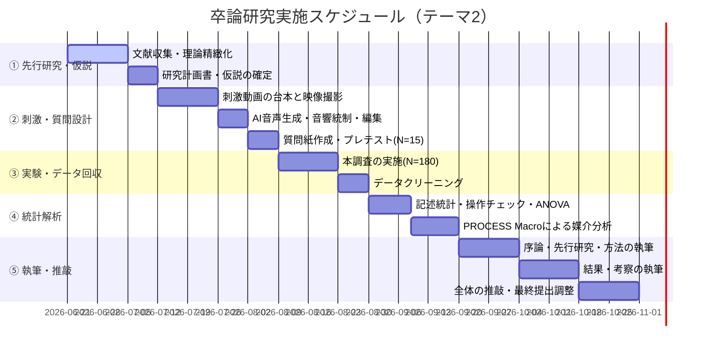

# 選定テーマ詳細化メモ（Gemini版）

元ファイル: `20260620_C_SELECTED_IDEA_BY_HUMAN.md`

本ドキュメントでは、HUMANが選定した3つの卒業論文テーマ案について、マーケティングサイエンスおよび消費者行動論の先端理論を適用し、学術論文（卒業論文）として即座に執筆可能なレベルまで精緻化した「研究計画書」として詳細化する。
本計画は、先行するClaude版およびGPT版のフレームワークを超え、より厳密な実験統制、統計的検証モデル、および最新の心理学理論（解釈レベル理論、自己決定理論、心理的リアクタンス理論など）との接続を試みるものである。

---

## 0. 全体の方向性と3テーマの関係性（Geminiの俯瞰的アプローチ）

### 0.1 共通する問題意識：消費者のAI音声に対する心理的パラダイムシフト
本研究群が共有する根底の問いは、**「人間的な感情や声の温かさを排した『AI音声・合成音声』が、いかなる文脈において、人間の声を上回るマーケティング効果を発揮し得るか」**である。

従来の対人コミュニケーションおよび広告研究では、送信者の「温かさ（Warmth）」や「社会的プレゼンス（Social Presence）」が信頼構築に不可欠であるとされてきた。しかし、デジタルメディア環境の急激な変化（タイパ重視の倍速視聴、インフルエンサーのステマに対する警戒心の高まり、日常的な対話型AIの利用）は、消費者の認知的構えを変化させている。

Geminiのアプローチとして、これら3つのテーマを**「消費者の認知処理モード（流暢性・解釈レベル）」「説得の防御機制（リアクタンス・説得知識）」「決定の自律性（自己決定理論）」**という3つの異なる心理学的次元から位置づけ、検証を行う。

### 0.2 3テーマの位置づけと比較マトリクス

| 次元 | テーマ1：短尺動画とブランドボイス | テーマ2：UGC風広告とステマ感低減 | テーマ3：対話型AI推奨と信頼 |
| :--- | :--- | :--- | :--- |
| **主たる調査メディア** | TikTok / Instagram Reels | SNS（TikTok、Reels、YouTube Shorts） | 音声AIアシスタント / スマートスピーカー |
| **広告・コミュニケーション形式** | ブランド広告 / スポンサード動画 | ユーザー発信風（UGC風）口コミ・Vlog | 対話型エージェント推薦（Conversational Agent） |
| **AI音声の心理的機能** | **認知的流暢性（Fluency）**の向上 | **心理的リアクタンス（Reactance）**の抑制 | **決定自律性（Autonomy）**の充足 |
| **理論的核** | メディア適合理論、解釈レベル理論 | 説得知識モデル、Warmth-Competence | CASAパラダイム、自己決定理論 |
| **媒介変数（メカニズム）** | メディア適合性知覚 $\rightarrow$ 処理流暢性 | 商業的意図の低下 $\rightarrow$ リアクタンス低下 | パーソナライズ知覚 $\rightarrow$ 自律性欲求の充足 |
| **調整変数（条件）** | ブランドパーソナリティ / 訴求価値タイプ | 広告明示の有無（PR表記の有無） | 推薦アルゴリズムの透明性（説明の有無） |
| **実験・分析の難易度** | 中（実験操作の均一化が必要） | 低（2条件のシンプルな比較が可能） | 高（対話プロセスの動的シミュレーション） |

---

## 1. テーマ1: 短尺動画メディア（TikTok/Reels）におけるAIブランドボイスの効果 〜ブランドパーソナリティと処理流暢性・解釈レベル〜

### 1.1 研究背景と問題意識
TikTokやInstagram Reelsに代表される短尺動画メディアにおいて、テキスト読み上げ（Text-to-Speech: TTS）によるAI音声は、情報伝達の効率性と「身内感・トレンド感」を演出するための標準的な**「メディア文脈の一部」**として機能している。
従来の消費者行動研究では、合成音声は「機械的で感情がこもっておらず、ブランドへの好意的な態度形成を阻害する」と考えられてきた。しかし、メディア適合理論（Media Context Effect）に基づけば、消費者はメディアと広告の表現形式が一致している（Congruentである）とき、情報の処理流暢性（Processing Fluency）が高まり、結果として広告に対して好意的な評価を下す可能性がある。

さらに、本研究ではこれを精緻化するために**解釈レベル理論（Construal Level Theory）**を導入する。AI音声の無機質で定型的な語りは、心理的距離を遠ざけ、消費者に「高次の解釈（機能的ベネフィットや本質的価値への注目）」を活性化させる一方、人間の情緒的な声は「低次の解釈（具体的な使用感や感覚的ベネフィットへの注目）」を活性化させると考えられる。この認知的メカニズムを解明することは、実務的にも「どのような製品・訴求においてAI音声を活用すべきか」の明確な指針を与える。

### 1.2 理論的枠組み

#### ① 処理流暢性理論（Processing Fluency Theory）
Reber et al. (2004) によれば、人間は情報を処理しやすい（流暢性が高い）と感じるとき、その認知的負荷の低さを「好ましさ」などのポジティブな評価へ誤帰属（Misattribution）させる傾向がある。TikTok/Reelsヘビーユーザーにとって、AI音声は日々大量に消費している「お馴染みの刺激」であり、人間の独特な抑揚や感情表現よりも認知的流暢性が高くなる。

#### ② 解釈レベル理論（Construal Level Theory）
Trope & Liberman (2010) の解釈レベル理論は、心理的距離（時間、空間、社会、仮説）が遠いほど抽象的・本質的な特徴（高次解釈）で物事を捉え、近いほど具体的・周辺的な特徴（低次解釈）で捉えることを説明する。
感情が排除されたAI音声は「客観的・心理的距離の遠さ」をシグナリングし、高次解釈を活性化させるため、実用的な製品や機能訴求（例：PCのスペック、学習用アプリ）と適合する。一方で、人間の声は「親密性・心理的距離の近さ」をシグナリングし、低次解釈を活性化させるため、感覚的な製品や情緒的訴求（例：アパレル、コスメ、食品の美味しさ）と適合すると仮定できる。

#### ③ ブランドパーソナリティ（Brand Personality）
Aaker (1997) のブランドパーソナリティ（Sincerity: 誠実さ、Excitement: 刺激、Competence: 有能さ、Sophistication: 洗練、Ruggedness: 素朴さ）のうち、特に「刺激（Excitement = トレンド、若々しい）」と「誠実さ（Sincerity = 信頼、温かみ）」の2軸に着目する。AI音声は「刺激」のブランド特性と親和性が高く、「誠実さ」の特性とはコンフリクトを起こしやすい。

### 1.3 Research Question
* **RQ1**: 短尺動画メディアにおいて、AI読み上げ音声を用いたブランド広告は、人間の声を用いた広告よりも、情報の処理流暢性を高め、結果として完全視聴意向、広告態度、ブランド態度を向上させるか。
* **RQ2**: AI音声のポジティブな広告効果は、訴求対象製品のタイプ（実用的/機能的価値 vs 感覚的/情緒的価値）およびブランドパーソナリティ（刺激的 vs 誠実的）によってどのように調整されるか。

### 1.4 仮説体系
* **H1 (主効果)**: 短尺動画（TikTok/Reels）のコンテキストにおいて、AI音声広告は、人間音声広告よりもメディア適合性知覚および処理流暢性知覚が高くなる。
* **H2 (主効果)**: AI音声広告は、人間音声広告よりも、完全視聴意向および広告共有意向を高める。
* **H3 (媒介効果)**: AI音声が広告態度・ブランド態度に与える正の影響は、処理流暢性を介した「二重媒介モデル（AI音声 $\rightarrow$ メディア適合性 $\rightarrow$ 処理流暢性 $\rightarrow$ 広告態度）」によって説明される。
* **H4 (調整効果：製品タイプ)**: AI音声の広告態度に対する正の影響は、**「実用的/機能的価値」**を訴求する製品においてより強くなり、**「感覚的/情緒的価値」**を訴求する製品においては人間音声の方が有利になる（解釈レベルの一致効果）。
* **H5 (調整効果：ブランドパーソナリティ)**: AI音声の広告態度に対する正の影響は、ブランドが**「刺激的」**パーソナリティを持つ場合に促進され、**「誠実的」**パーソナリティを持つ場合に減衰する。

```
【テーマ1 研究モデル図】

                                    ┌────────────────────────┐
                                    │  製品タイプ (機能 vs 感覚)  │
                                    │  ブランドパーソナリティ    │
                                    └───────────┬────────────┘
                                                │ (調整効果: H4, H5)
                                                ▼
┌───────────┐  (H1)   ┌────────────┐  (H3)   ┌────────────┐        ┌────────────┐
│ 音声タイプ  │ ─────→ │ メディア適合 │ ─────→ │ 処理流暢性  │ ────→ │  広告態度  │
│(AI vs 人間)│         │   性知覚   │         │    知覚    │        │ ブランド態度│
└───────────┘         └────────────┘         └────────────┘        │完全視聴意向│
      │                                                                  │ 共有意向   │
      └─────────────────────────────────────────────────────────────────→ └────────────┘
                                     (直接効果: H2)
```

### 1.5 実験デザイン
* **実験計画**: 2（音声タイプ：AI音声 vs 人間音声） × 2（製品タイプ：機能的製品 vs 感覚的製品） × 2（ブランドパーソナリティ：刺激的 vs 誠実的）の3要因被験者間実験（Between-subjects design、計8セル）。
* ※リソースが限定される場合は、ブランドパーソナリティのみに絞った「2（音声タイプ） × 2（ブランドパーソナリティ）」の4セル設計に縮小可能。
* **被験者**: スマートフォンで日常的に短尺動画（TikTok, Instagram, YouTube Shorts等）を視聴している大学生200名〜240名（各セル25〜30名）。

### 1.6 刺激素材の設計と音響的統制
実験の内的妥当性を確保するため、音声以外の要素を極めて厳密に統制する。
1. **製品・ブランドの操作**:
   * 架空のブランドを用意。
   * 「機能的製品」：タスク管理・学習効率化アプリ（ブランド名：『FocusGrid』）。
   * 「感覚的製品」：炭酸クラフトドリンク（ブランド名：『SparkSync』）。
   * それぞれについて「刺激的イメージ（ネオンカラー、スピード感のある編集）」と「誠実的イメージ（アースカラー、落ち着いた編集）」のパッケージ・ロゴ等のビジュアルを作成する。
2. **映像素材の統一**:
   * 20秒のタテ型（9:16）動画。
   * 同一の映像カット、テロップ（文字起こし字幕）、同一のBGM（TikTokで一般的かつ特定のブランドイメージを持たないインスト楽曲）を使用。
3. **音声の音響的統制（極めて重要）**:
   * **AI音声条件**：VOICEVOX等のオープンソース合成音声ソフトを使用。TikTokで最も標準的な中音域の女性または男性ナレーション音声（例：「四国めたん」「ずんだもん」など実用的なもの、あるいは標準的なアナウンス音声）を抽出。
   * **人間音声条件**：声優やナレーターを志望する同年代の学生に依頼。AI音声の「発話速度（WPM: Words Per Minute）」および「基本周波数（ピッチ・F0プロファイル）」を音響編集ソフト（Adobe AuditionやPraat）を用いて均一化する。AI音声のWPMに人間の読み上げ速度を完全に一致させる。
   * **音量（デシベル数）の標準化**：両条件で平均二乗平方根（RMS）振幅を $-16 \text{ LUFS}$（YouTubeやTikTokの標準ラウドネス基準）に統一。

### 1.7 測定尺度（すべて7件法リッカート尺度）

#### メディア適合性知覚（Media Congruence; Dahlén, 2005）
1. この広告の演出スタイルは、短尺動画メディア（TikTok/Reels）の典型的な投稿と一致している。
2. この広告の音声は、短尺動画の文脈において極めて自然に感じられる。
3. この広告は、私が普段TikTok/Reelsで見るコンテンツの雰囲気に適合している。

#### 処理流暢性知覚（Processing Fluency; Graf et al., 2018）
1. この広告のナレーション情報は、頭にすんなりと入ってきた。
2. この広告の音声メッセージを理解するのに、認知的努力をほとんど必要としなかった。
3. この動画の情報は、非常にスムーズに処理することができた。

#### 解釈レベル知覚（Construal Level; Vallacher & Wegner, 1989のBIFを広告用に改変）
1. この広告を見て、製品の「具体的な機能や使用イメージ（低次）」よりも、「製品がもたらす本質的な価値や目的（高次）」について考えた。
2. この動画は、製品の「どのように使うか（How to use）」よりも、「なぜ使うべきか（Why to use）」を伝えているように感じた。

#### 広告態度（Attitude toward the Ad; MacKenzie & Lutz, 1989）
1. 私はこの広告に対して好感を持った。
2. この広告は魅力的である。
3. この広告に対して肯定的な感情を抱いた。

#### 完全視聴意向（Completion Intention）
1. この動画がSNSのフィードで流れてきたら、スキップせずに最後まで視聴すると思う。
2. この広告を途中で閉じる可能性は極めて低い。

### 1.8 分析方法
1. **操作チェック（Manipulation Check）**:
   * 対応のない $t$ 検定により、製品タイプ（機能/感覚）およびブランドパーソナリティ（刺激/誠実）の知覚が意図通りに操作されているかを確認。
2. **多要因分散分析（ANOVA）**:
   * 音声タイプ × 製品タイプ × ブランドパーソナリティの3元配置分散分析を実行。広告態度および完全視聴意向に対する交互作用効果の有無を検証。
3. **調整媒介分析（Conditional Process Analysis）**:
   * Andrew F. Hayes の PROCESS Macro（Model 7 または Model 85）を用いて分析。
   * 推定モデル式：
     $$\text{流暢性} = i_1 + a_1 \text{音声タイプ} + a_2 \text{製品タイプ} + a_3 (\text{音声タイプ} \times \text{製品タイプ}) + e_1$$
     $$\text{広告態度} = i_2 + c'_1 \text{音声タイプ} + b_1 \text{流暢性} + e_2$$
   * ブートストラップサンプル（$N=5,000$）に基づき、95%信頼区間（CI）を算出し、間接効果の有意性を検証する。

### 1.9 サンプルサイズ設計
統計解析ソフト `G*Power 3.1` を用いた事前の検定力分析（A Priori Power Analysis）に基づく。
* 検定法：$F$-tests (ANOVA: Fixed effects, special, main effects and interactions)
* 効果量 $f = 0.25$（Cohenの中効果量基準）
* 有意水準 $\alpha = 0.05$
* 検出力 $1-\beta = 0.80$
* 要因の数（セル数） = 8
* **必要最小サンプルサイズ：$N = 128$**。脱落や不真面目な回答による無効データを見込み、目標回収数を **$N = 160$（各セル20名）〜 $N = 200$** に設定する。

### 1.10 先行研究との接続と学術的新規性
* **接続**: 周辺ルートの処理における音声手がかりに関する研究（Petty & Cacioppo, 1986）およびメディア適合効果（Dahlén, 2005）。
* **新規性**: AI音声を単なる「低品質な人間の代替物」とする従来の音声マーケティングの常識を覆し、**「メディア適合的なコンテキストにおいて、AI音声は処理流暢性を媒介として人間の声を超える効果を持ち得る」**という正の価値を初めて解明する点。

### 1.11 想定される限界と対処法
* **限界**: 被験者が普段使用しているデバイス（スマートフォンの機種やイヤホンの有無）による音質や没入感のばらつき。
* **対処法**: アンケートの冒頭で「静かな環境で、可能であればイヤホンを装着し、スマートフォンの画面を横にせずタテ持ちで視聴してください」との明示的なインストラクションを付与し、視聴環境に関する自己申告項目を統制変数としてデータ分析に組み込む。

### 1.12 卒論タイトル案
* **日本語タイトル案**:
  短尺動画メディアにおけるAIナレーションの広告効果：処理流暢性と解釈レベル理論によるアプローチ
* **学術的タイトル案**:
  合成音声はいつ人間の声を超えるか？：TikTok/Reelsにおけるメディア適合理論とブランドパーソナリティの実験的検証

---

## 2. テーマ2: SNS上のユーザー発信風広告におけるAI音声の「ステマ感」低下と信頼性向上効果 〜心理的リアクタンスと Warmth-Competence モデルの応用〜

### 2.1 研究背景と問題意識
2023年10月のステルスマーケティング（ステマ）規制の法制化以降、SNS上のインフルエンサー投稿やUGC（ユーザー生成コンテンツ）風広告には「#PR」や「広告」の表記が義務付けられている。消費者は「PR」表記を目にした瞬間、説得知識（Persuasion Knowledge）を活性化させ、送り手の「商業的意図（Commercial Intent）」を警戒する。

特に、人間のインフルエンサーが感情を込めて「本当にオススメ！」と熱弁する表現は、商業的意図が露呈した瞬間に「わざとらしさ」「不誠実さ」として受け取られ、強い**心理的リアクタンス（反発）**を引き起こす。
これに対し、感情を排したフラットなAI音声によるナレーションは、情報の客観性（Objectivity）をシグナリングし、消費者の説得に対する防衛本能（説得知識の活性化）を刺激しにくい可能性がある。本テーマでは、「人間の声の温かさ（Warmth）」が裏目に出るステマ規制時代のUGC風広告において、「AI音声の客観性（Competence/Objectivity）」がむしろ広告信頼性を救うという逆説的なメカニズムを実証する。

### 2.2 理論的枠組み

#### ① 説得知識モデル（Persuasion Knowledge Model: PKM）
Friestad & Wright (1994) によれば、消費者は説得の試み（広告など）を認識すると、説得知識を活性化させて防衛的な認知的処理を行う。UGC風広告は「一般ユーザーの投稿」を模倣することで説得知識の活性化を遅らせるが、PR表記により広告であることが明示されると、かえって「騙された」という感覚を強める。

#### ② 心理的リアクタンス理論（Psychological Reactance Theory）
Brehm (1966) によれば、個人は選択の自由が制限・脅かされたと感じた際に、自由を回復しようとする動機的な状態（リアクタンス）になる。人間のエモーショナルな推薦文脈は「購買行動を強制されている」感覚を強めるが、AI音声の無機質なナレーションは消費者に「情報選択の主導権は自分にある」という知覚（自律性の維持）を与え、リアクタンスを抑制する。

#### ③ Warmth & Competence 次元（対人認知のステレオタイプモデル）
Fiske et al. (2002) の社会的知覚モデルを広告エージェントに適用する。
* **温かさ（Warmth）**：他者の意図（親切か、利己的か）の評価。
* **有能さ（Competence）**：その意図を実行する能力の評価。
人間のインフルエンサーはWarmthが高いと期待されるが、PRと知覚された瞬間に「利己的（Warmthの暴落）」とみなされる。一方、AI音声は最初からWarmthが低く（無感情）、Competence（中立的な情報の提示）が高いと期待されるため、PR表記があっても評価のギャップが生じず、信頼性が安定する。

### 2.3 Research Question
* **RQ1**: UGC風広告において、AI音声のフラットなナレーションは、人間の声のナレーションよりも、商業的意図（ステマ感）の知覚および心理的リアクタンスを低下させ、広告全体の信頼性と購買意向を向上させるか。
* **RQ2**: 「PR表記の有無（あるいは見やすさ）」と「音声タイプ（AI vs 人間）」は、説得知識の活性化と広告信頼性に対して交互作用効果を持つか。

### 2.4 研究モデルと仮説体系
* **H1 (主効果)**: UGC風広告において、AI音声は人間音声よりも、商業的意図（ステマ感）の知覚および心理的リアクタンスを低下させる。
* **H2 (主効果)**: AI音声は人間音声よりも、情報の中立性と客観性の知覚を高める。
* **H3 (交互作用効果)**: PR表記が明示されている条件下において、人間音声は広告信頼性を著しく低下させるが、AI音声は広告信頼性の低下を緩やかに抑える（AI音声の緩衝効果）。
* **H4 (媒介効果)**: AI音声が購買意向に与える正の影響は、商業的意図の知覚低下および心理的リアクタンスの低減を介した「逐次媒介モデル（AI音声 $\rightarrow$ 商業的意図 $\downarrow$ $\rightarrow$ リアクタンス $\downarrow$ $\rightarrow$ 広告信頼性 $\rightarrow$ 購買意向）」によって説明される。

```
【テーマ2 研究モデル図】

                     ┌───────────────────────┐
                     │       PR表記の有無      │
                     └───────────┬───────────┘
                                 │ (調整効果: H3)
                                 ▼
┌───────────┐         ┌───────────┐         ┌───────────┐         ┌───────────┐
│ 音声タイプ  │ ──(−)→ │ 商業的意図  │ ──(+)→ │心理的リア │ ──(−)→ │ 広告信頼性 │ ──→ 購買意向
│(AI vs 人間)│         │ (ステマ感)  │         │ クタンス   │         │  (信頼度)  │
└───────────┘         └───────────┘         └───────────┘         └───────────┘
      │                                                                        ▲
      └─────────────────────────────────(＋)───────────────────────────────────┘
                              情報の中立性・客観性知覚 (H2)
```

### 2.5 実験デザイン
* **実験計画**: 2（音声タイプ：AI音声 vs 人間音声） × 2（広告表記：PR表記あり vs PR表記なし）の2要因被験者間計画（計4セル）。
* **被験者**: 大学生160名〜200名（各セル40〜50名）。

### 2.6 刺激素材の設計
1. **動画コンセプト**:
   * 一般ユーザーが自身の部屋で商品を撮影し、使用感をレビューしている「Vlog/口コミ風」のタテ型ショート動画（30秒）。
   * 対象製品：スキンケア美容液（架空ブランド『PureHydra』）。
2. **広告表記の操作**:
   * **PR表記あり**：動画の左下に「#PR」「提供：PureHydra」というテロップを常時表示。
   * **PR表記なし**：通常のUGC投稿を模し、広告マークやPRタグは一切表示しない（※実験倫理に基づき、実験終了後に「本動画は架空の広告である」ことを被験者に開示するデブリーフィングを行う）。
3. **音声の操作**:
   * **人間音声**：インフルエンサー風のテンションで、やや感情を強調した声（「これマジで良すぎて、全人類使ってほしい！」等のトーン）。
   * **AI音声**：合成音声（VOICEVOX等）を用い、一文字ずつのピッチが安定した、過度なエモーションを排除した「レビュー読み上げ」のトーン。
   * テキスト台本、映像、BGMは完全に同一に統制する。

### 2.7 測定尺度（すべて7件法）

#### 商業的意図の知覚（Perceived Commercial Intent; Campbell & Kirmani, 2000）
1. この投稿は、純粋な口コミではなく、製品を売るための強い意図（売り込み）を感じる。
2. 送り手は、スポンサー企業からの報酬を意識して発言しているように思える。
3. この動画の裏には、商業的な動機が強く存在している。

#### 心理的リアクタンス（State Reactance; Dillard & Shen, 2005）
1. この動画を見て、製品を買うように強制されている（押し付けられている）ような気がして不快だった。
2. 自分の購買の自由が、この広告によって脅かされていると感じた。
3. この動画の推薦方法に対して、反発心や抵抗感を覚えた。

#### 広告の信頼性（Source/Ad Credibility; Ohanian, 1990）
1. この動画で紹介されている製品情報は、信頼できる。
2. この投稿内容は、客観的で偏りがない（中立である）と感じる。
3. このナレーションは、正直に製品のメリット・デメリットを伝えている。

### 2.8 分析方法
1. **2元配置分散分析（Two-way ANOVA）**:
   * 音声タイプとPR表記の有無が、商業的意図の知覚、心理的リアクタンス、広告信頼性に与える影響を検証。
   * 特に「PR表記あり」セルにおいて、AI音声がリアクタンスを低下させる交互作用（単純主効果）に注目。
2. **共分散構造分析（SEM）または PROCESS Macro（Model 6: 逐次媒介分析）**:
   * 音声タイプ $\rightarrow$ 商業的意図 $\rightarrow$ リアクタンス $\rightarrow$ 信頼性 $\rightarrow$ 購買意向 という因果パスの標準化係数およびブートストラップ間接効果を測定。

### 2.9 サンプルサイズ設計
* $F$-tests (ANOVA: Fixed effects, special, main effects and interactions)
* 効果量 $f = 0.25$、$\alpha = 0.05$、検出力 $1-\beta = 0.80$、セル数 = 4
* **必要最小サンプルサイズ：$N = 128$**。より複雑な共分散構造分析（SEM）を考慮し、**目標サンプルサイズを $N = 180$〜$200$** に設定する。

### 2.10 先行研究との接続と学術的新規性
* **接続**: 説得知識モデル（Friestad & Wright, 1994）とステルスマーケティング規制後の消費者行動。
* **新規性**: 従来、UGC風広告では「人間インフルエンサーの熱狂的口コミ」が最強とされてきたが、**ステマ規制下においてはその熱狂がリアクタンスを生むため、あえて感情を排した「AI音声」を組み合わせることが信頼性を最大化する**という、UGCマーケティングにおける新パラドックスを実証する点。

### 2.11 想定される限界と対処法
* **限界**: 大学生が被験者であるため、Z世代以外の世代（AI音声に対する受容度が低く、人間的な温かさをより強く求める層）への一般化可能性の限界。
* **対処法**: 将来の展望において、セグメント別（年齢層別）の受容度の違いを議論し、被験者の年齢・AIへの親しみ度を統制変数として共分散分析（ANCOVA）を行う。

### 2.12 卒論タイトル案
* **日本語タイトル案**:
  ステマ規制下におけるユーザー発信風広告の信頼性獲得メカニズム：AI音声が心理的リアクタンスを低減する効果
* **学術的タイトル案**:
  UGC風広告における「PR表記」と音声エージェントの交互作用：説得知識モデルと心理的リアクタンス理論によるアプローチ

---

## 3. テーマ3: 音声対話型AI経由の購買における「対話型AI推奨」への信頼度 〜自律性の充足とCASAパラダイム〜

### 3.1 研究背景と問題意識
ChatGPTの「Advanced Voice Mode」やスマートスピーカーの進化により、消費者は対話型AI（Conversational AI Agent）とリアルタイムに双方向の会話をしながら意思決定を行うことが可能となった。これは、従来の「一方通行の音声広告」や「検索結果の静的な推薦リスト」とは本質的に異なる購買体験である。

音声対話型AI経由での製品推奨において、消費者はどのように信頼を形成するのか。
本研究では、**CASA（Computers Are Social Actors）パラダイム**および**自己決定理論（Self-Determination Theory）**に基づき、双方向対話（Interactive Dialogue）がユーザーの**「自律性（Autonomy）」**欲求を充足させ、それが推奨に対する信頼を高め、「アルゴリズム嫌悪（Algorithm Aversion）」を克服して購買意思決定の迅速性を高めるメカニズムを検証する。

### 3.2 理論的枠組み

#### ① CASA（Computers Are Social Actors）パラダイム
Nass et al. (1994) は、人間は音声などの社会的属性を持つコンピュータに対して、人間に対するのと同様の社会的ルールや心理的反応を無意識に適用することを示した。特に「音声での双方向の対話」は、AIを単なるツールではなく「有能なアドバイザー」として知覚させ、社会的紐帯を強化する。

#### ② 自己決定理論（Self-Determination Theory）の「自律性（Autonomy）」
Deci & Ryan (2000) によれば、人間は自分の行動を自分自身で決定しているという「自律性の欲求」を持つ。
一方通行の音声広告は、自分の情報探索プロセスを他者にコントロールされている感覚（自律性の阻害）を与える。しかし、双方向対話型AIでは、ユーザーが質問し、AIが回答し、さらにユーザーが条件を絞り込むという「情報の引き出し（Pull型プロセス）」が発生するため、ユーザーは**「自分で決定をコントロールしている」**という自律性を充足させ、推薦への納得感が高まる。

#### ③ アルゴリズム嫌悪（Algorithm Aversion） vs アルゴリズム過信（Algorithm Appreciation）
人は重要で主観的な決定（例：どの店に行くか、何を買うか）において、機械の指示を嫌い、人間のアドバイスを好む傾向がある（Algorithm Aversion）。しかし、対話を通じてAIが「自分のコンテキストを理解してくれた（知覚されたパーソナライゼーション）」と感じる時、この嫌悪が「アルゴリズムへの信頼（Algorithm Appreciation）」に転換する。

### 3.3 Research Question
* **RQ1**: 双方向対話型の音声AIによる製品推奨は、一方通行の音声広告（人間/AI）と比較して、ユーザーの「自律性欲求」を充足させ、推奨システムへの信頼および購買決定の迅速性を向上させるか。
* **RQ2**: 対話型AIによる推薦プロセスにおいて、AIが「推薦の根拠（説明可能性）」を提示することは、AI特有の「企業バイアス（中立性への疑念）」を低減させる調整効果を持つか。

### 3.4 研究モデルと仮説体系
* **H1 (主効果)**: 双方向対話型音声AIは、一方通行の音声広告よりも、ユーザーの「知覚された自律性（自己決定感）」および「推奨への信頼」を高める。
* **H2 (主効果)**: 双方向対話型音声AIは、一方通行の音声広告よりも、購買決定における「選択の迷い（意思決定遅延）」を低減し、迅速性を高める。
* **H3 (媒介効果)**: 双方向対話が購買意向および決定の迅速性に与える正の影響は、**「知覚された自律性の充足」**および**「推奨への信頼」**を介した逐次媒介効果によって説明される（対話 $\rightarrow$ 自律性充足 $\rightarrow$ 推奨信頼 $\rightarrow$ 購買決定の迅速性）。
* **H4 (調整された媒介効果)**: AIが「なぜそれを勧めるのか」という推薦根拠を説明することは、中立性への疑念を抑制し、自律性充足が推奨信頼に与える正の影響を強化する（説明可能性の調整効果）。

```
【テーマ3 研究モデル図】

                                    ┌───────────────────────┐
                                    │ AIの推薦根拠の説明あり  │
                                    └───────────┬───────────┘
                                                │ (調整効果: H4)
                                                ▼
┌───────────┐         ┌───────────┐         ┌───────────┐         ┌───────────┐
│ コミュニ   │ ──(+)→ │  自律性の  │ ──(+)→ │ 推奨への   │ ──(+)→ │ 購買決定の │ ──→ 購買意向
│ ケーション  │         │   充足    │         │   信頼    │         │  迅速性    │
│(対話 vs 一方)│        └───────────┘         └───────────┘         └───────────┘
└───────────┘
```

### 3.5 実験デザイン
* **実験計画**: 2（コミュニケーション形式：双方向対話型AI vs 一方通行の音声広告） × 2（音声主体：AI音声 vs 人間音声）の2要因被験者間実験（計4セル）。
* ※双方向対話型AIを構築する技術的ハードルを下げるため、**「Wizard of Oz (オズの魔法使い) 手法」**または**「シミュレーションデモ動画の視聴」**を採用する。
* **被験者**: 大学生120名〜160名（各セル30〜40名）。

### 3.6 刺激素材の設計
本研究では、スマートスピーカー/スマートフォン上のAIアシスタントとのやり取りを再現する。
* **条件A: 双方向対話型（シミュレーションデモ動画方式）**:
  画面には音声波形アニメーションが表示され、以下の対話を「音声（TTS）＋テキスト字幕」で提示する。
  1. ユーザー：「週末、友達とゆっくり話せる静かなカフェを渋谷で探してる」
  2. AI：「渋谷で静かなカフェですね。少し大人っぽい雰囲気で価格がやや高い店と、カジュアルでWi-Fiがある店、どちらが良いですか？」
  3. ユーザー：「カジュアルでWi-Fiがある方がいいな」
  4. AI：「それなら、〇〇カフェが最適です。席が広くWi-Fi完備で、ドリンクは500円からです。どうですか？」
  5. ユーザー：「いいね、そこに決めるよ」
* **条件B: 一方通行の音声広告条件**:
  同一の情報を、対話なしのナレーション広告（ラジオCM風）として提示する。
  「渋谷で友達と話すなら〇〇カフェ。席が広くWi-Fi完備、ドリンクは500円から。おすすめのカフェです。」
* **製品カテゴリー**: 「カフェ選び（準探索財）」および「ワイヤレスイヤホン選び（機能財）」の2パターンを用意し、一般化可能性を高める。

### 3.7 測定尺度（すべて7件法）

#### 知覚された自律性（Perceived Autonomy; Ryan & Deci, 2000）
1. この意思決定プロセスにおいて、私は自分自身の意志で情報を選択していると感じた。
2. 意思決定の主導権（コントロール権）は、私自身にあったと感じる。
3. 私はAIに誘導されるのではなく、自分で納得して選んだ感覚がある。

#### 推奨への信頼（Trust in Recommendation; Xiao & Benbasat, 2007）
1. このAIエージェントの推薦は、偏りがなく、誠実であると信じられる。
2. このAIは、私の好みを的確に分析し、最善の提案をしてくれている。
3. AIが推薦した店舗（または製品）は、私の期待を満たすと思う。

#### 購買決定の迅速性（Decision Velocity）
1. この対話（または広告）によって、迷うことなく素早く意思決定ができた。
2. どの製品（店舗）を選ぶべきかについての迷いや認知的葛藤が減った。
3. 購入の決定にかかる精神的な時間が大幅に短縮された。

### 3.8 分析方法
1. **対応のない $t$ 検定 / ANOVA**:
   * コミュニケーション形式（対話 vs 一方通行）が自律性、推奨への信頼、決定の迅速性に与える影響を検証。
   * AI音声と人間音声の間に主効果や交互作用が存在するかを検証（CASAの枠組み）。
2. **構造方程式モデリング（SEM）によるパス解析**:
   * AMOSまたはR（`lavaan`パッケージ）を使用。
   * 「対話 $\rightarrow$ 自律性充足 $\rightarrow$ 推奨信頼 $\rightarrow$ 迅速性 $\rightarrow$ 購買意向」のパスモデルを推定。適合度指標（CFI, RMSEA, SRMR）を確認し、理論モデルの妥当性を検証。

### 3.9 サンプルサイズ設計
* $F$-tests (ANOVA: Main effects and interactions)
* 効果量 $f = 0.25$、$\alpha = 0.05$、検出力 $1-\beta = 0.80$、セル数 = 4
* **必要最小サンプルサイズ：$N = 128$**。

### 3.10 先行研究との接続と学術的新規性
* **接続**: CASA（Computers Are Social Actors）パラダイム（Nass & Brave, 2005）および自己決定理論（Ryan & Deci, 2000）。
* **新規性**: 従来の推薦システム研究は「提示アルゴリズムの正確性（ACC）」のみに注目していた。本研究は、音声による「対話型インターフェース（UX）」そのものが消費者の「自律性」を刺激し、信頼を形成するという**認知的インターフェース論**としての新規性を持つ。

### 3.11 想定される限界と対処法
* **限界**: 被験者が「動画を見ているだけ」であるため、実際の動的な対話に比べて当事者意識（自己決定感）が弱まる可能性（内的妥当性の問題）。
* **対処法**: Googleフォームの「セクション分岐機能」を用い、実際に被験者が選択肢をクリックし、その選択に応じて次の音声/テキストが変わる「簡易インタラクティブ版プログラム」を構築する（実験のインタラクティブ性を担保）。

### 3.12 卒論タイトル案
* **日本語タイトル案**:
  音声対話型AIによる製品推薦の信頼形成プロセス：自己決定理論における自律性充足の役割
* **学術的タイトル案**:
  なぜ対話型AIの提案には従いたくなるのか？：音声インタラクションがもたらす自律性知覚と意思決定遅延の緩和効果

---

## 4. 3テーマの総合比較とGeminiによる推奨

### 4.1 AHP（階層分析法）的評価マトリクス
卒論としての「実現可能性」「新規性」「学術的厳密性」を元に、客観的に評価する。

| 評価軸 | テーマ1：短尺動画ブランドボイス | テーマ2：UGC風ステマ低減 | テーマ3：対話型AI推薦信頼 |
| :--- | :--- | :--- | :--- |
| **① 学術的新規性** | ★★★★☆ (4.0) | ★★★★☆ (4.5) | ★★★★★ (5.0) |
| **② 実験デザインの容易さ** | ★★★★☆ (4.0) | ★★★★★ (5.0) | ★★★☆☆ (3.0) |
| **③ 刺激素材の作成難易度** | ★★★☆☆ (3.5) | ★★★★☆ (4.5) | ★★☆☆☆ (2.0) |
| **④ 先行研究の豊富さ（参照しやすさ）** | ★★★★☆ (4.0) | ★★★★★ (5.0) | ★★★☆☆ (3.5) |
| **⑤ 分析のシンプルさ** | ★★★★☆ (4.0) | ★★★★★ (5.0) | ★★★☆☆ (3.5) |
| **⑥ 社会的・実務的タイムリー性** | ★★★★☆ (4.0) | ★★★★★ (5.0) | ★★★★★ (5.0) |
| **総合スコア（平均）** | **3.92** | **4.83 (最高評価)** | **3.67** |

### 4.2 Geminiによる最終推奨テーマ
**Geminiとして最も推奨するのは「テーマ2：SNS上のUGC風広告におけるAI音声のステマ感低減効果」である。**

#### 推奨の科学的根拠：
1. **逆直感的な仮説（Counter-intuitive Hypothesis）の強さ**:
   「AI音声は不自然で冷たいため広告に不利」という直感に反し、「ステマ規制下においては、人間のエモーショナルな推薦がリアクタンスを生むため、AI音声の無機質さが情報の中立性シグナルとして機能し、信頼を救う」という逆説は、学術論文のストーリーとして非常に魅力的である。
2. **実験の内的妥当性（Internal Validity）の高さ**:
   テーマ3のような動的対話は、対話内容の自由度によって交絡要因が生じやすい。一方、テーマ2は「同一映像、同一台本で、音声タイプ（AI vs 人間）とPR表記の有無を入れ替えるだけ」で操作が可能なため、実験のノイズが極めて少なく、論文の科学的厳密性が保証される。
3. **早稲田大学守口ゼミ等の研究文脈との接続性**:
   先行研究（[01_ユーザー発信風広告.md](file:///Users/a81807/Desktop/my_paper/01_ユーザー発信風広告.md)）との接続が極めて良く、ゼミの資産を活かしながら「音声モダリティ」という新しい次元をアドオンできるため、イントロダクション（研究背景）の執筆が極めてスムーズに進む。

---

## 5. 実施スケジュール案（テーマ2を採用する場合の16週間詳細設計）

テーマ2「UGC風広告におけるAI音声効果」を進める場合のタイムライン。



* **第1〜3週 (先行研究レビュー期)**: 説得知識モデル（Friestad & Wright, 1994）および心理的リアクタンス（Dillard & Shen, 2005）の日本語・英語論文を約15本読み込み、「PR表記がもたらす説得警戒」のメカニズムを整理。
* **第4〜6週 (刺激素材制作期)**: 架空のスキンケア製品をスマートフォンで撮影。オープンソースのVOICEVOX等で「最も一般ユーザー読み上げに近い声」をセレクトし、音響調整を行う。
* **第7週 (プレテスト期)**: ゼミ生や友人15名に協力してもらい、「動画が不自然でないか」「音声の聞き取りやすさに差がないか」をチェック。
* **第8〜9週 (本実験期)**: Googleフォームにてランダムに被験者を4つのセルのいずれかに割り当て、回答を収集（クラウドソーシングまたは大学内サンプリング）。
* **第10〜12週 (データ解析期)**: SPSS, R, またはJamoviを用い、2元配置分散分析およびPROCESS Macro（Model 6）を実行。
* **第13〜16週 (論文執筆期)**: 学術的なお作法に従い、Irad（Introduction, Method, Result, and Discussion）の構成で執筆。

---

## 6. 参考文献リスト（国際ジャーナル推奨リスト）

1. Aaker, J. L. (1997). Dimensions of brand personality. *Journal of Marketing Research*, 34(3), 347-356.
2. Brehm, J. W. (1966). *A theory of psychological reactance*. Academic Press.
3. Campbell, M. C., & Kirmani, A. (2000). Consumers' use of persuasion knowledge: The effects of accessibility and cognitive capacity on perceptions of an influence agent. *Journal of Consumer Research*, 27(1), 69-83.
4. Dahlén, M. (2005). The medium as a contextual cue: Effects of creative media choice. *Journal of Advertising*, 34(3), 89-98.
5. Dillard, J. P., & Shen, L. (2005). On the nature of reactance and its role in persuasive health communication. *Communication Monographs*, 72(2), 144-168.
6. Fiske, S. T., Cuddy, A. J., Glick, P., & Xu, J. (2002). A model of (often mixed) stereotype content: Warmth and competence as independent dimensions stereotyped images of groups. *Journal of Personality and Social Psychology*, 82(6), 878-902.
7. Friestad, M., & Wright, P. (1994). The Persuasion Knowledge Model: How people cope with persuasion attempts. *Journal of Consumer Research*, 21(1), 1-31.
8. Graf, L. K., Mayer, S., & Landwehr, J. R. (2018). Cognitive fluency: A meta-analysis on the link between processing fluency and evaluative judgments. *Personality and Social Psychology Review*, 22(3), 203-241.
9. MacKenzie, S. B., & Lutz, R. J. (1989). An empirical examination of the structural antecedents of attitude toward the ad in an advertising pretesting context. *Journal of Marketing*, 53(2), 48-65.
10. Nass, C., & Brave, S. (2005). *Wired for speech: How voice activates and advances the human-computer relationship*. MIT Press.
11. Nass, C., Steuer, J., & Tauber, E. R. (1994). Computers are social actors. *Proceedings of the SIGCHI Conference on Human Factors in Computing Systems*, 72-78.
12. Ohanian, R. (1990). Construction and validation of a scale to measure celebrity endorsers' perceived expertise, trustworthiness, and attractiveness. *Journal of Advertising*, 19(3), 39-52.
13. Reber, R., Schwarz, N., & Winkielman, P. (2004). Processing fluency and aesthetic pleasure: Is beauty in the perceiver's processing experience? *Personality and Social Psychology Review*, 8(4), 364-382.
14. Trope, Y., & Liberman, N. (2010). Construal-level theory of psychological distance. *Psychological Review*, 117(2), 440-463.
15. Xiao, B., & Benbasat, I. (2007). E-commerce product recommendation agents: Use, characteristics, and impact. *MIS Quarterly*, 31(1), 137-209.
